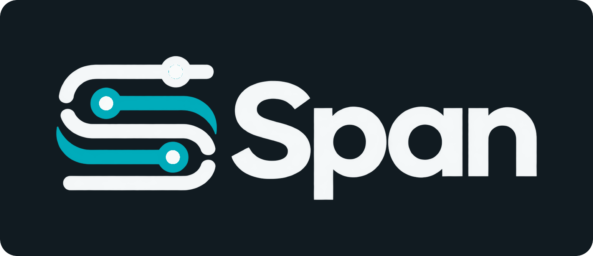

<h1 align="center">
  
</h1>

<p align="center">
  <strong>Build a knowledge factory for your codebase.</strong>
</p>

<p align="center">
  Stop making every coding agent rediscover what previous engineering work
  already established.
</p>

<p align="center">
  <a href="https://modelcontextprotocol.io"></a>
  <a href="https://github.com/pontivus-com/span/actions/workflows/ci.yml"></a>
  <a href="https://github.com/pontivus-com/span/blob/master/LICENSE"></a>
  
  
  
  <a href="https://github.com/pontivus-com/span/stargazers"></a>
</p>

<p align="center">
  <a href="#your-agents-keep-starting-over"><strong>Why Span</strong></a> ·
  <a href="#how-span-closes-the-loop"><strong>How it works</strong></a> ·
  <a href="#quick-start"><strong>Quick start</strong></a> ·
  <a href="https://github.com/pontivus-com/span/tree/master/docs"><strong>Docs</strong></a>
</p>

## Your agents keep starting over

A coding agent can read a lot of context for the task in front of it: source,
tests, documentation, configuration, issue history, and the current
conversation.

But once the task ends, much of the useful understanding produced during that
work disappears with it.

The next agent often has to reconstruct the same answers:

- Why does this subsystem work this way?
- Which files and tests actually matter?
- Which requirement or design decision governs this code?
- What did the last investigation already establish?
- Did a recent change make that understanding stale?

That repeated rediscovery costs time, burns context, and makes agent behavior
less consistent as a codebase grows.

This is becoming a broader agent-engineering problem. In
[How to build a knowledge factory](https://www.langchain.com/blog/knowledge-factory),
LangChain argues that better models and more context are not enough on their
own. Useful agents also need maintained knowledge: reusable understanding that
is collected, curated, and kept up to date so future work starts from more than
raw context.

Span brings that knowledge-factory model to software engineering.

## Turn engineering work into knowledge that compounds

Span gives coding agents a maintained knowledge layer for the codebase they are
working on.

Instead of treating every session as a fresh investigation, Span lets real
engineering work improve the starting point for the next task.

With Span, agents can:

- **start from what is already known** about the exact part of the system they
  are working on;
- **retain useful understanding produced during real work** instead of losing it
  with the conversation;
- **see which project guidance applies** to the code, rather than guessing from
  filenames or document prominence;
- **share reviewed knowledge with future agents** without treating every
  task-local conclusion as automatically trustworthy; and
- **revisit only the knowledge affected by change** when source or governing
  guidance moves.

The outcome is simple: **every useful investigation can leave the next agent
better informed.**

## How Span closes the loop

A knowledge factory works when doing the work continuously improves the
knowledge available for future work.

Span makes that loop explicit for software:

1. **Start with maintained knowledge.** The agent asks about the file, symbol,
   service, or domain it is working on and gets what is already known.
2. **Do the engineering work normally.** The agent reads, searches, edits, and
   tests with its existing tools.
3. **Keep what the work establishes.** Useful understanding can be captured
   while the evidence and reasoning are still fresh.
4. **Review before broad reuse.** Stable knowledge can be reviewed separately
   before it becomes shared context for later agents.
5. **Keep it aligned with change.** When code or project guidance changes, Span
   identifies the knowledge that needs another look instead of invalidating
   everything.

**Working agents capture. Reviewers curate. Span maintains the lifecycle.**

Span does not need to replace your coding agent or your existing development
workflow. It runs beside the agent as an MCP server and gives that workflow a
persistent software-knowledge layer.

## Built for software, not generic memory

Software knowledge is different from ordinary memory because it depends on
things that change.

An explanation may be useful today and wrong after a source edit. Code may stay
the same while a requirement, contract, or design decision changes around it.
And knowing what the implementation does is not the same as knowing what it is
supposed to follow.

Span is designed around those realities.

It keeps retained understanding connected to the evidence and project guidance
it depends on, so future agents can get not just remembered information, but
maintained software knowledge.

That is the core distinction:

> **Span does not just remember software knowledge. It maintains it against the
> things it depends on.**

## What you get

For a coding agent working on a real task, Span can provide a focused working
context that answers:

- **What do we already know about this part of the system?**
- **What project guidance applies here?**
- **What changed, and what knowledge now needs another look?**

The underlying lifecycle is deliberately conservative: captured understanding
does not automatically become shared truth, and Span does not invent project
authority. The detailed model is documented separately for readers who need it.

## Quick start

The currently verified installation path is Linux with Python 3.12+, Node.js,
and npm.

From a source checkout:

```bash
python3 scripts/install-span.py --repo /path/to/your/repo
span-install --verify-only
```

For a published package release, install `span-mcp` and run:

```bash
span-install --repo /path/to/your/repo
```

Then reconnect your coding agent and use Span from the engineering task you were
already going to do.

See [Install and connect](docs/install.md) for setup details and
[First investigation](docs/onboarding-runbook.md) for the first end-to-end
workflow.

## Go deeper

The README is intentionally the overview. The documentation set uses progressive
disclosure so you can go deeper only when you need to.

- [Using Span](docs/usage.md) — the normal day-to-day workflow.
- [First investigation](docs/onboarding-runbook.md) — a complete first-use
  walkthrough.
- [Concepts and product model](docs/README.md#concepts) — how maintained
  knowledge, change, evidence, and project guidance fit together.
- [MCP reference](docs/mcp.md) — exact public tool grammar.
- [Install and connect](docs/install.md) — host configuration, upgrades, and
  operator detail.
- [Documentation index](docs/README.md) — contributor, authority, verification,
  and programme material.

Span 1.0 is currently in Beta. Exact candidate verification and host-delivery
status are recorded in [acceptance](docs/acceptance.md).

## Contributing

See [contributing](CONTRIBUTING.md). Security reports go through
[SECURITY.md](SECURITY.md); support expectations are in [SUPPORT.md](SUPPORT.md).

## Registry

Official MCP Registry entry: `io.github.pontivus-com/span`

mcp-name: io.github.pontivus-com/span

## License

Span is licensed under **Apache License 2.0** (`Apache-2.0`). See [LICENSE](LICENSE).
