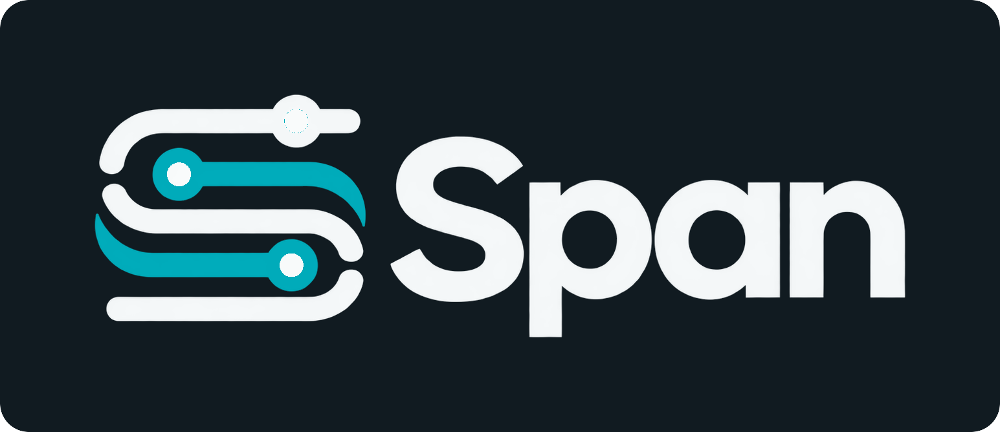

<h1 align="center">
  
</h1>

<p align="center">
  <strong>Carry useful investigations into the next coding session.</strong>
</p>

<p align="center">
  Span keeps the explanations your coding agent worked out, the evidence
  behind them, and what needs another look when that evidence changes.
</p>

<p align="center">
  <a href="https://modelcontextprotocol.io"></a>
  <a href="https://github.com/pontivus-com/span/actions/workflows/ci.yml"></a>
  <a href="https://github.com/pontivus-com/span/blob/master/LICENSE"></a>
  
  
  
  <a href="https://github.com/pontivus-com/span/stargazers"></a>
</p>

<p align="center">
  <a href="#quick-start"><strong>Quick start</strong></a> ·
  <a href="#how-it-works"><strong>How it works</strong></a> ·
  <a href="https://github.com/pontivus-com/span/tree/master/docs"><strong>Docs</strong></a>
</p>

## Keep the understanding your agent worked for

A coding agent traces a request across services, checks the tests, finds the
contract, and explains why the boundary exists. The next session should be
able to find that explanation and see whether its support still holds.

Span makes that investigation reusable. It is a local MCP server where agents
record coherent explanations with exact source support, explicit gaps, and
version history. Later agents can discover the explanation from the current
surface view, then inspect what is current, disputed, or changed.

The coding agent does the thinking. Span keeps the record and checks its
support.

Three tools — `ask`, `record`, `reconsider` — carry the
[agent lifecycle](docs/lifecycle-contract.md#required-agent-completion): find
current understanding, retain a supported conclusion, and re-align after change.

## How it works

1. **Start from the surface.** Ask for the current surface view with no question
   or request identity. Span returns current grouped understanding with status,
   or a gap with concrete source pointers. Select source bytes explicitly only
   when the investigation needs them.
2. **Retain established understanding.** Save one conclusion at a time with the file
   it rests on, or declare a service/domain surface for a cross-file
   explanation. Work that started outside Span can be recorded directly; the
   flat create derives support from the locator you already read.
3. **Reuse in a fresh session.** Ask for the surface document view without a
   question, then select the applicable current conclusion.
4. **Reassess after change.** Check affected dependencies, investigate what
   changed, then confirm, correct, replace, or withdraw the explanation.
   Earlier versions remain inspectable.

One explanation can span code, tests, CSS, configuration, and contracts. The agent retains supported conclusions as part of the investigation.

## See the lifecycle

Illustrative tool sequence, not literal request JSON. The installed schemas
and [MCP reference](docs/mcp.md) own the wire grammar.

```text
ask(surface)
  → current grouped Answer, or Gap with source pointers

agent selects needed source bytes explicitly when required
ask(surface, request_id, evidence)
  → same Answer/Gap classification plus evidence admission/context

agent investigates and records what it established

record(kind="understanding", conclusion, locator|observation_id|support)
  → compact acceptance with receipt selector, version, and live qualification

fresh session asks the surface
  → current document view grouped by recorded question
ask(selector=RecordedQuestionSelector)
  → exact known recorded-question membership
ask(selector=UnderstandingSnapshotSelector)
  → exact recorded explanation, live support, gaps, and challenges

supporting source changes
reconsider(changed_paths)
  → every affected surface, with containment, direct, and indirect reasons,
    per-conclusion support state, and a re-establishment context

agent investigates and records a correction against the expected version
  → version 2; version 1 remains history
```

Pure reuse names the surface and returns all current membership grouped by
recorded question. Exact targeted reuse uses `RecordedQuestionSelector` only
when that recorded question is already known. Wording is never treated as
semantic equivalence, and a returned conclusion remains a starting point for
judgment.

## Know what can be reused

| Qualification | What the agent can conclude |
| --- | --- |
| `CURRENT` | The declared support still passes its checks. Applicability and semantic correctness still need judgment. |
| `REASSESSMENT_REQUIRED` | Source, authority, premise, or recorded membership support changed. Revisit the affected explanation. |
| `UNVERIFIABLE` | Required support cannot be established. The limitation stays explicit. |

Gaps and challenges remain visible independently of support currency. Matching
bytes do not settle a dispute, and test existence does not establish a pass.
Independent verification records the observations or evidence actually tested and preserves
failures as failures.

Recording is atomic. Ordinary acceptance returns a receipt selector plus the
accepted coordinates and live qualification; the immutable receipt remains in
storage and is retrieved explicitly when exact replay/audit detail is needed.
The caller preserves identity before sending, so retrying the same identity and
content recovers the retained acceptance after a lost response or restart.

## Quick start

The verified installation path is Linux with Python 3.12+, Node.js, and npm.
From a checkout containing the current candidate:

```bash
python3 scripts/install-span.py --repo /path/to/your/repo
```

For a published package release, install `span-mcp` with your Python package
manager and run `span-install --repo /path/to/your/repo`. See
[install and connect](docs/install.md) for registration, verification, and the
offline store transition.

The installer provisions the managed structural indexer, runtime, skills, and
host integration. With the default global OpenCode scope, it registers the
Span lifecycle plugin and MCP server in the same global OpenCode configuration.
Repeat installs use the receipt's absolute MCP path unless
`--opencode-config` explicitly relocates it.
Reconnect your coding agent after upgrade so it receives the new tools and
instructions. Verify operational setup with:

```bash
span-install --verify-only
```

Setup creates no understanding. Begin with the relevant surface from your actual task;
see [using Span](docs/usage.md).

## Beta host status

The 0.10.3 repository/installable contract is verified through the built package
and installed stdio MCP lane. Candidate-specific live model-host conversion was
not rerun from this execution environment; earlier captures are historical and
are not reused as 0.10.3 acceptance evidence.

| Host | 0.10.3 candidate status |
| --- | --- |
| Codex | Integration target retained; candidate-specific live model-delivery **UNVERIFIED**. |
| OpenCode | Integration target and packaged notice delivery retained; candidate-specific live model-delivery **UNVERIFIED**. |
| Claude Code | Managed registration/health support retained; authenticated model-delivery remains **UNVERIFIED**. |
| Other MCP hosts | Manual stdio connection remains available; host-specific model-delivery is **UNVERIFIED**. |

Registration, hook configuration, and model-delivered behavior are distinct.
Hooks provide lifecycle reminders; retrieval and recording still check support
when hooks are absent. See [host integration](integrations/hosts/triggers.md).

## Fits around your agent

Span runs locally over stdio and keeps state outside target repositories. Your
agent uses its own model, tools, edits, and test runner. Span does not invoke a
model or store provider credentials. Structural search helps investigation;
recorded conclusions retain the agent's interpretation and declared support.

The intended benefit is continuity between sessions and a focused review of
changed support. Recording and host delivery have costs. Measured cost is
class-specific: repeated reuse of a covered surface breaks even at two uses on
the tested tasks, while single-use implementation is currently more expensive
than reading. This beta makes no universal time/token-saving claim or completed
comparative product-fitness ACCEPT claim. See [acceptance](docs/acceptance.md).

## Status and documentation

This checkout describes **0.10.2**: required agent lifecycle guidance across the
functional pyramid and delivered instructions, cold-repository lifecycle notices,
and ranged evidence admission with continued live support checking. The public
operations remain `ask`, `record`, and `reconsider`; storage remains schema 11.
See [the changelog](CHANGELOG.md) for verification and upgrade instructions.

- [Install and connect](docs/install.md)
- [Using Span](docs/usage.md) and [first investigation](docs/onboarding-runbook.md)
- [Agent lifecycle](docs/lifecycle.md) and [MCP reference](docs/mcp.md)
- [Support and reassessment](docs/freshness.md)
- [Evidence and authority](docs/authority-trust.md)
- [Scope and boundaries](docs/scope.md) and [FAQ](docs/faq.md)
- [Architecture](docs/architecture.md), [repository overview](docs/overview.md), and [all docs](docs/README.md)
- [Changelog](CHANGELOG.md)

## Contributing

See [contributing](CONTRIBUTING.md). Preserve the central contract: useful
understanding stays attached to its support, noncurrent or uncertain state
stays explicit, and corrections preserve history. Security reports go through
[SECURITY.md](SECURITY.md); support expectations are in [SUPPORT.md](SUPPORT.md).

## Registry

Official MCP Registry entry: `io.github.pontivus-com/span`

mcp-name: io.github.pontivus-com/span

## License

Span is licensed under **Apache License 2.0** (`Apache-2.0`). See [LICENSE](LICENSE).
