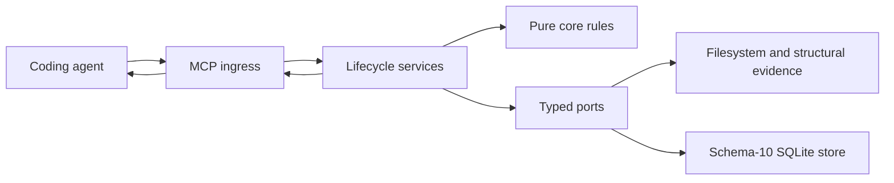

# Architecture

Span keeps agent-authored understanding attached to its declared support.
The interpreting agent owns meaning; deterministic core rules validate state
transitions and classify support; the shell owns effects.

## Ownership

| Boundary | Responsibility |
| --- | --- |
| Target repository and its owners | Implementation, tests, contracts, declared governance. |
| Coding agent | Investigation, interpretation, applicability, edits, external verification. |
| `core/model` and `core/schema` | Canonical immutable carriers, strict parsing, reference-only recording wire. |
| `core/identity.py`, `core/recording.py` | Digests, receipt replay decisions, validated version/challenge transitions. |
| `core/support_rules.py` | Pure source, authority, premise-membership, and discovery support decisions. |
| `ports/` | Typed evidence, structural, lifecycle-store, and authority boundaries. |
| `service/` | Gather observations, compose discovery/admission/recording/qualification through ports. |
| `shell/` | Filesystem, clocks, git, structural provider, SQLite transactions, installation, MCP. |

The functional core imports no filesystem, database, MCP SDK, network, or
model provider. Services call core rules; adapters do not duplicate semantic
decisions. One canonical typed carrier crosses each internal boundary.
Wire projection resolves references once into that contract; it does not
introduce a second domain representation or compatibility writer.

## Request and persistence path

Strict MCP ingress parses a canonical request. The service reads typed state
and evidence, calls core rules, and invokes the owning persistence operation.
The SQLite shell commits semantic transitions and receipts atomically.
MCP serializes the result as text and structured content from one result.

Questions and evidence admission may persist recoverable operational contexts
and immutable observations. They do not author conclusions. Recording writes
understanding versions, conclusion revisions, explicit challenges, and
independent verification runs. Ordinary startup and navigation do not build
structural state; explicit setup owns provider currency work.

## Shared state and recovery

The schema-10 store holds contexts and receipts across process/session
restarts. The reasoning caller preserves request/submission identity before
dispatch. Matching receipt replay precedes new-write checks, including checks
that could fail after context expiry or source changes. Compare-and-set
versions and challenge revisions reject conflicting concurrent updates.
SQLite transactions serialize the actual commits.

There is no process-local interpretation continuation, campaign runtime, or
second semantic writer. Earlier stores use a separately invoked offline
archive/export/stage/activate protocol; startup never migrates them.

## Currency and limits

Support is checked from declared source observations, authority declarations,
exact premise revisions, and recorded discovery membership. Changed support
requires agent reassessment; deterministic rules do not rewrite the meaning.
Challenges and gaps remain separate from support currency. A current snapshot
may be incomplete or disputed.

Hooks are optional notices and do not establish currentness. Skills guide the
agent and have no runtime semantic authority. See [lifecycle](lifecycle.md),
[ports](ports.md), and [MCP reference](mcp.md).
