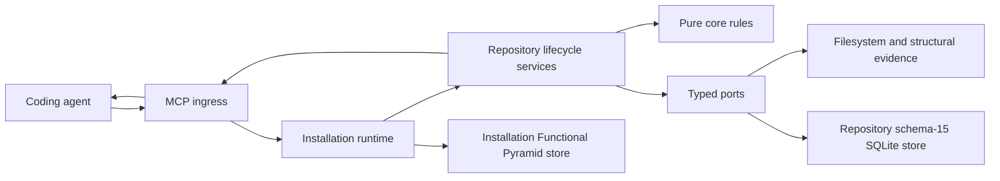

# Architecture

Span follows a functional-core / imperative-shell design:



The central rule is simple:

> **Core rules decide semantics. Services compose them. Ports define
> capabilities. Shell adapters own effects.**

A change belongs at the lowest layer that actually owns the decision.

## Ownership boundaries

| Boundary | Owns |
| --- | --- |
| Target repository and repository owners | Implementation, tests, canonical project authority, governance declarations |
| Coding agent / human investigator | Investigation, interpretation, conformance judgment, edits, external verification |
| `src/span/core/model`, `core/schema` | Canonical immutable carriers and strict parsing contracts |
| `src/span/core/identity.py`, `core/recording.py` | Deterministic identities, replay decisions, validated semantic/version transitions |
| `src/span/core/support_rules.py` and Functional Pyramid core rules | Pure support/state/graph decisions |
| `src/span/ports/` | Typed capabilities for evidence, structure, stores, authority, declarations, and repository-qualified governance |
| `src/span/service/` | Lifecycle composition across core rules and ports |
| `src/span/shell/` | Filesystem, clocks, Git, structural provider, SQLite transactions, installation, host integration, MCP transport |

The functional core imports no filesystem, database, MCP SDK, network client, or
model provider.

Shell adapters do not get to invent semantic decisions because they are closer
to the effects. Services do not create shadow domain shapes to avoid using the
canonical core contracts.

## Installation and repository composition

Span has two persistence/composition levels.

### Repository lifecycle state

Each registered repository has its own lifecycle store containing repository
semantic/audit state: retained understanding, observations, challenges,
verification, receipts, and repository-local support indexes.

The current Beta-3 repository store is schema **15**.

### Installation state

The installation runtime owns capabilities that span registered repositories,
including:

- registered-repository resolution;
- the installation Functional Pyramid store;
- repository-qualified evidence/authority access;
- Functional Pyramid composition; and
- the shared cross-repository dependency-effect path.

Functional Pyramid participation, instance versions, exclusions, and
installation-scoped receipts therefore do not live inside one selected
repository database.

Repository services are composed from the installation runtime so an ordinary
repository operation and a Functional Pyramid operation cannot quietly use
different governance models.

## Request path

A normal request follows this direction:

```text
MCP request
  → strict ingress
  → installation/repository composition
  → lifecycle service
  → typed ports + pure core rules
  → owning persistence operation when needed
  → canonical result
  → MCP egress
```

Strict ingress validates the public request into canonical contracts before
semantic composition.

Services read typed state/evidence through ports, apply core decisions, and
invoke the one persistence owner for a state change.

The SQLite shell commits accepted semantic transitions and their receipts
atomically.

MCP projects the canonical result to text/structured content; transport does not
create a second semantic model.

## Meaning is never authored by the infrastructure

Evidence admission can persist observations and recoverable investigation
context. It does not author a semantic conclusion.

Recording can persist agent-authored conclusions, curation dispositions,
challenges, verification, and history. The semantic meaning still comes from
the investigator/reviewer.

Likewise, the Functional Pyramid resolves declared project authority and
applicability. It does not infer governing meaning from repository structure.

This separation is governed by
[Foundations](foundations.md), especially F1/F5/F11/F13.

## Change effects use one semantic path

Implementation change and governance change can both affect retained knowledge.

Span therefore uses the same service-owned dependency/effect composition for:

- ordinary changed-scope `reconsider`; and
- Functional Pyramid participation/governance effects.

There is no shell-side semantic coordinator and no reduced repository-local
fallback that can disagree with the production installation composition.

## Persistence, replay, and concurrency

Accepted understanding history is immutable/versioned.

The caller preserves recording identity before dispatch. Matching receipt replay
is resolved before attempting a new write, so a lost response can be recovered
without repeating the semantic mutation.

Compare-and-set understanding/challenge versions prevent silent concurrent
overwrite. SQLite transactions serialize committed state changes.

Operational contexts may expire without deleting accepted semantic/audit
history.

Older repository schemas transition through the explicit offline procedure in
[Install and connect](install.md#upgrade-an-existing-store). Runtime open never
silently migrates them.

## Where to go next

- [Repository overview](overview.md) — where code and tests live.
- [Port contracts](ports.md) — exact typed capability boundaries.
- [Structural evidence and indexing](indexing.md) — structural-provider role.
- [MCP reference](mcp.md) — public transport grammar.
- [Contributing](contributing.md) — development and verification workflow.

Binding behavior is owned by the Functional Pyramid documents, not by this
architecture guide.
