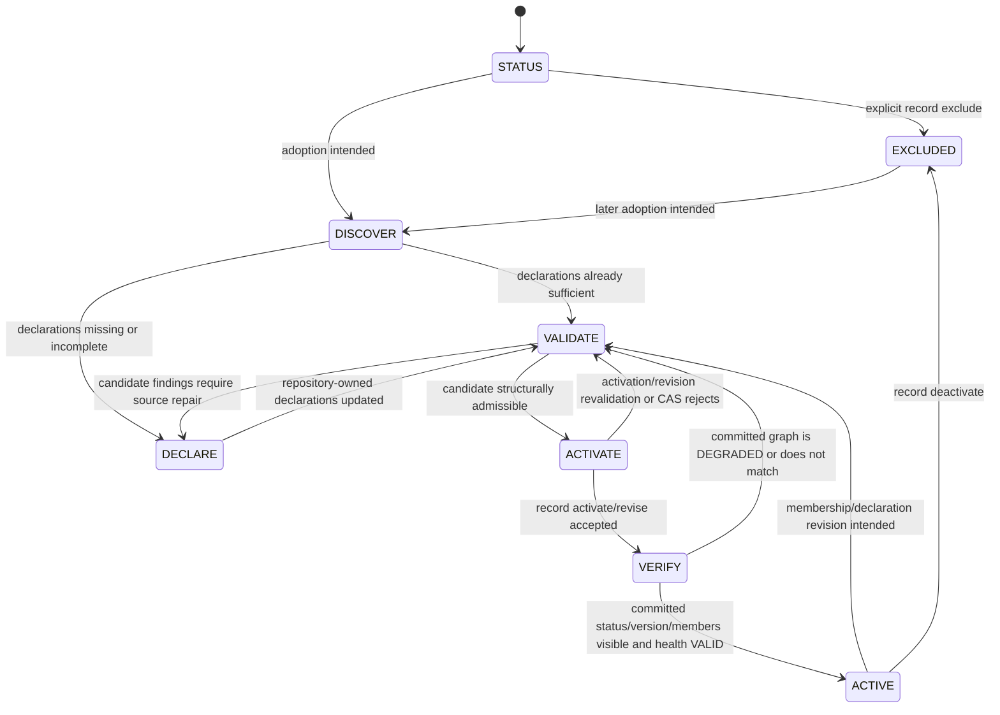
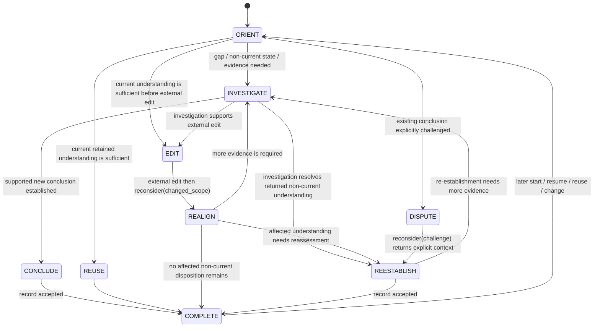

# Span lifecycle contract — layer 2

**Status: binding target for Span 1.0 Beta.** This is the second foundational layer, beneath the
[goals](goals.md) (layer 0) and layer 1 ([foundations](foundations.md)). Layer 1
states the axioms about the agent and the principles of the system. This layer
turns them into functional requirements: the operations that exist, what the
agent sends and receives, and what is deliberately not the agent's job. The
[functional design](functional-design.md) (layer 3) and the implementation
(layer 4) must be derivable from this document.

Authority and derivation between layers are defined in the
[requirements pyramid model](requirements-pyramid.md).

**1.0 Beta target contract, 21 November 2026.** Runtime implementation and host
delivery are pending. These requirements describe the target behavior; they do
not certify that the installed server already conforms.

## 1. Position in the pyramid

This document is layer 2. Layer 0 is [goals](goals.md), layer 1 is
[foundations](foundations.md), layer 3 is the
[functional design](functional-design.md), and layer 4 is the
[technical design](technical-design.md). The ownership of each layer, the
placement test for a new statement, the rule against restatement, and the
direction of derivation are defined in the [requirements pyramid model](requirements-pyramid.md).

## 2. Terminology

| Term | Meaning |
| --- | --- |
| **Surface** | Defined in [foundations](foundations.md) §1. A **declared surface** (`SERVICE`, `DOMAIN`) has an explicit name and boundary. A **path surface** (`FILE`, `SYMBOL`) is identified by its path or canonical locator and is created on first reference, with no separate declaration step. |
| **Request identity** | The caller's stable identifier for one request that writes or issues a context. A retry reuses it; a new intentional act uses a new one. It carries no Span state and is not a token. A pure change-scope `reconsider` is a read and carries none. |
| **Boundary** | The paths or symbols that a surface covers. Used for discovery, change mapping, and the `unexamined` count. |
| **Granularity** | The kind of surface being asked about. The same question at file scope and at service scope is a different question with a different answer. |
| **Understanding** | The retained, versioned unit: one question over one surface, with supported conclusions. |
| **Answer** | What `ask` returns when usable understanding exists for the surface. |
| **Conclusion** | One supported statement inside an understanding. |
| **Evidence** | Exact source content — locator, range, content identity. |
| **Support** | The typed dependency of a conclusion on evidence, a discovery boundary, an authority, or another conclusion. |
| **Surface status** | The distribution over a surface's own conclusions and its boundary: current, stale, unassessed, and unexamined, with descendant status reported separately. |
| **Gap** | The absence of usable understanding, with its cause and the means to resolve it. |
| **Challenge** | An explicit dispute against a conclusion revision. |
| **Verification** | An independent run recorded against the observations or evidence actually tested. |
| **Functional context** | A declared responsibility/applicability context used by the Functional Pyramid. It is not a semantic surface. Several contexts may apply to one path and one context may cover several paths. |
| **Functional rule** | One stable canonical governing rule with a declared layer, owner and direct governing rule IDs. Its substantive text remains at its canonical source. |
| **Functional Pyramid** | The declared graph from repository paths through functional contexts to applicable functional rules and their governing rules. |
| **Functional Pyramid instance** | One explicit, versioned set of registered repositories whose repository-owned declarations may resolve together. Membership makes cross-repository identities reachable; it does not by itself make any rule applicable. |
| **Functional Pyramid participation state** | Durable repository participation is exactly `UNCONFIGURED`, `EXCLUDED`, or `ACTIVE`. Only an accepted Functional Pyramid `record` changes it. |
| **Functional Pyramid health** | Live qualification of an ACTIVE pyramid: `VALID` or `DEGRADED`, computed from present declarations/member availability and never persisted by a hidden read-time transition. |
| **Functional Pyramid coverage** | Each member declares one explicit repository-relative functional coverage scope using the same canonical selector model as Functional Context applicability, plus `PARTIAL | COMPLETE`. PARTIAL permits explicit uncovered scope inside that boundary; COMPLETE asserts the whole declared boundary is covered. Scope outside the boundary is not implicitly functional. |
| **Functional Pyramid view** | The governing projection for the selected semantic scope: resolved contexts, rule identities/layers, canonical owner references, governing relationships, provenance, downstream dependency information where the selected scope owns rules, and unresolved relationships. It is orientation/governance state, not an agent-authored conclusion and not a copy or summary of canonical rule content. |
| **Route support** | Server-derived support binding a normative conclusion to the exact Functional Pyramid route that applied when the conclusion was established. |

An understanding may be unsupported. An **answer never is** — that asymmetry is
the point of the whole system.

## 3. The three public lifecycle operations

| Decision | Source |
| --- | --- |
| The surface is obtain, retain, re-align — and no more | F6 |
| Correctness cannot depend on the agent remembering a step | A4 |
| The agent supplies only what it already holds | F7 |
| A refusal must carry the way forward | A8 |
| Only valid content is an answer | F2, A7 |
| Scope is a surface and status is reported at its granularity | F9 |
| Understanding is retained, versioned, and reachable without the transcript | F3 |
| Reuse must beat maintaining documentation or acting on stale understanding | F8 |
| Surface-bound semantic content is the documentation, not a separate artifact | G6 |
| Canonical governing sources remain canonical and are referenced rather than copied | G6, F1, F11 |
| The governing path from first principles to implementation is available at orientation | G7, F10, F11 |
| Repository registration and Functional Pyramid participation are different lifecycle states | G8, F12 |
| Functional Pyramid adoption and revision use the same obtain/retain/re-align lifecycle | G8, F6, F12 |
| Cross-repository governance effects follow the explicit Functional Pyramid instance | G3, F4, F12 |
| There are no per-intent operations | F5 |

*What does this do*, *what depends on it*, *what breaks if I change it*, and
*is this still true* remain questions over retained understanding rather than
operations. Declared governance is different: for a participating repository,
Span resolves the Functional Pyramid as server-owned orientation and support
state. It does not generate an answer to "what should govern"; it returns what
the repository explicitly declared to govern the selected scope. The agent still
judges semantic and conformance meaning.

Audit needs no sixth operation. Every answer carries the surface status, because
a reader who cannot tell current from stale has not been answered (F9).

Exactly three public tools realize these moments: `ask`, `record`, `reconsider`.
The installer binds repositories; the host supplies general structural
navigation. Functional Pyramid resolution is not general structural navigation:
it is deterministic resolution of explicit governance declarations and is folded
into the three lifecycle operations.

## 4. Public lifecycle operations

### 4.0 Answer boundary

State this before the operations, because everything else depends on it.

- Span answers from **retained understanding scoped to a surface**. It does not
  synthesise an answer from first principles.
- A first-contact question on an unassessed surface returns a **gap**, not a
  generated answer.
- When code changes, Span **marks containment and enumerates support loss, direct
  and indirect**; it never rewrites meaning. The answer is restored by the agent
  through `record`.
- Every answer reports the surface status. Status is never optional and never a
  single stamp.
- For a participating repository, ordinary current surface obtain also reports
  the Functional Pyramid view for the selected semantic scope. The view may be
  fully resolved while semantic understanding is a Gap, or unresolved while
  descriptive understanding remains usable.
- Governing route state never substitutes for semantic understanding, and
  semantic support never substitutes for governing applicability.

### 4.1 `ask` — obtain

Exactly one form is supplied:

| Form | Inputs | Effect |
| --- | --- | --- |
| Surface obtain | `repository_id` and exactly one of `surface` / `reference` | Read current grouped understanding and status; no request ID or context |
| Exact recorded-question obtain | `selector=RecordedQuestionSelector{repository_id, surface, question}` | Read current membership for that exact recorded question on that exact surface; no similarity matching, request ID or context |
| Explicit source admission | Surface obtain inputs, non-empty `evidence` selection and `request_id` | Admit selected sources/ranges into a recoverable evidence-only context |
| Exact current obtain | `selector=CurrentUnderstandingSelector{repository_id, understanding_id}` | Read that understanding's current membership with live support/status |
| Historical/audit obtain | `selector=UnderstandingSnapshotSelector{repository_id, understanding_id, version?}`, `ReceiptRetrievalSelector{repository_id, request_id}`, or `FunctionalPyramidReceiptSelector{request_id}` | Retrieve the exact snapshot or receipt in its owning namespace; never current-answer content |
| Functional Pyramid state | `selector=FunctionalPyramidSelector{repository_id? , pyramid_id?}`, exactly one identity | Read durable participation/instance state, current version/members and live health; no semantic conclusion is generated |
| Functional Pyramid candidate validation | `selector=FunctionalPyramidCandidateSelector{action="activate", members}` or `FunctionalPyramidCandidateSelector{action="revise", pyramid_id, expected_version, members}` | Purely validate the exact intended activation/revision against current registered repositories and repository-owned declarations; return complete findings without mutation |
| Evidence continuation | `continuation` | Read the next selected-evidence page using its bound repository/request/context |

A surface is an exact `{kind, locator}` identity, never containment. A reference
must resolve to exactly one surface; otherwise return `AmbiguousSurface` with
exact candidates. Ordinary surface/reference obtain accepts no free `question`
field. Recorded questions remain metadata grouped in the document view, and F3's
targeted question reachability is the explicit
`RecordedQuestionSelector{repository_id, surface, question}`. The `surface` input in both ordinary obtain and this selector uses
`SurfaceReference`. In each form `repository_id: str` is the sole namespace; the surface
carries `kind` and `locator`; its optional nested `repository_id` must be absent
(including no explicit null). A nested repository input is a structural rejection,
not an override or a second matching rule. `question: str` is non-empty. The selector
matches the stored question exactly within the supplied surface; it performs no
normalisation, paraphrase matching, similarity search, or cross-surface lookup.
If no membership matches the exact recorded question, return `Gap/unassessed`,
not a separate
`no_match` reason. Exact selectors and continuation carry their own repository
binding; a separate repository override is forbidden. Unknown exact identities
have an explicit lookup rejection and public recovery, not an invented surface
or generated answer.

**Functional Pyramid obtain and candidate validation.** A
`FunctionalPyramidSelector` identifies exactly one registered repository or one
existing pyramid instance and returns its durable participation state and, for
ACTIVE participation, current live health.

A `FunctionalPyramidCandidateSelector` validates the exact intended write.
`action="activate"` carries the complete proposed member intents.
`action="revise"` additionally carries the target `pyramid_id` and
`expected_version`; validation therefore sees removals, current membership and
version conflicts instead of validating an anonymous replacement set. Each
member names its registered `repository_id`, exact repository-owned declaration
source requests, one explicit `functional_scope`, and
`coverage=PARTIAL | COMPLETE`.

`functional_scope` uses the same canonical Functional Pyramid scope-selector
carrier used by Functional Context declarations. It is not `EvidenceScope` and
does not introduce a second applicability grammar. It declares the repository
scope for which this member is claiming Functional Pyramid coverage.

Candidate validation is pure. It resolves only the submitted member/declaration
sources and stable identities reached from them, validates COMPLETE coverage
against the declared functional scope, and never activates, repairs or copies
governing content. The same candidate may be submitted later through `record`;
recording revalidates present source state rather than trusting an earlier
validation result.

**Pure obtain.** Surface/reference obtain returns all CURRENT conclusions on
that surface, grouped by recorded question, with status, gaps, verification,
limitations and explicit omissions. For a repository that participates in the
Functional Pyramid, the same obtain resolves the selected scope's declared
Functional Pyramid and returns it as orientation state. An exact recorded-question selector first
restricts membership by surface and exact recorded question; a current selector
restricts membership to its returned understanding identity. Both then use the
same support/status owners as the grouped view. These pure forms create no
investigation context and require no caller request identity. A genuinely
unassessed surface or selected recorded question remains a Gap. Recovery
identifies the missing investigation and available source pointers as
`Gap.source_pointers: tuple[EvidenceRequest, ...]` without pretending they are
admitted observations or fingerprinted proof. The field is always present, empty
when no concrete source locator can be identified; it is not an admission result.
Each pointer has the existing EvidenceRequest locator/ranges shape. Omitted
pointers are named in Gap.omitted and its recovery; no directory is misrepresented
as an observed file. No source bodies are delivered unsolicited.

**Explicit evidence.** `evidence` is a non-empty selection of exact source
locators and ranges. Admission is restricted to the resolved surface and issued
scope. Whole-file requests are explicit. A valid selection returns the same
Answer/Gap classification plus one canonical `EvidenceAdmissionView` shared by
both result kinds. Its fields are `context: InvestigationContextRef`,
`outcomes: tuple[EvidenceAdmissionOutcome, ...]`,
`deliveries: tuple[EvidenceDelivery, ...]`, `continuation: str | None`,
`omitted: tuple[str, ...]`, and `truncated: bool`. It reuses the existing evidence request/outcome,
source-observation and range owners; it does not define parallel source-copy or
range shapes. `EvidenceDelivery` has exactly `observation_id: SourceObservationId`
and `unit: EvidenceUnit`. The unit carries the existing EvidenceRef, content,
content_fingerprint and content_range; the ID associates each whole/partial
delivery with its admitted observation. Immutable SourceObservation stores the
reference, content hash and delivered ranges, not the source bytes; delivery
re-reads and verifies the hash, and a continuation does not mutate the
observation to represent a page. For disjoint ranges, deliver separately positioned EvidenceUnit fragments
rather than labeling concatenated text as contiguous. Before admission, `EvidenceRequest` is the exact source-pointer
and selection carrier; after observation, `EvidenceRef` remains the canonical
observed/cited source identity inside `SourceObservation`. Each admission
outcome is tied to its request, and admitted/already-admitted outcomes name the
observation addressed by each delivery. Initial admission outcomes cover every
requested item in request order. Continuation pages use the same EvidenceDelivery
carrier in `EvidencePage.deliveries: tuple[EvidenceDelivery, ...]`; the other
EvidencePage fields are `continuation: str | None`, `omitted: tuple[str, ...]`
and `truncated: bool`. They do not repeat the full admission batch.
Source identities/ranges remain exact on every page. Missing, unreadable and
omitted sources remain explicit. Source or store failure is not semantic absence.
The request identity binds the complete selection; identical retries recover the
same context. Admission does not imply the agent read all selected bytes or
established meaning. The host owns structural navigation; Span never guesses
relevant symbols/ranges.

**Context reference.** A returned `context` is one canonical
`InvestigationContextRef{repository_id, context_id}`, emitted by its owning
persisted context. It is not an unqualified ID. Context-bound operations derive
routing from that reference and reject independent repository overrides. The
reference grants no authority; liveness, scope and membership are checked at the
owner. Pure obtains have no context. Context inspection remains internal/admin.

**Continuation.** A continuation binds repository, investigation context,
original request identity/digest and next evidence position. It introduces no
separate storage or retention lifecycle. Each page advances by at least one
unit or exact line range; an oversized unit splits at line boundaries. Omission
is explicit and recoverable. One line that cannot fit is refused explicitly.
Wrong binding, malformed or absent references return a typed rejection with
public recovery. Genuine operational access failure is Unavailable. A missing
row is not labeled expired or reaped without evidence. Identical continuation
replay against the same live context returns the same page across restart.

**The agent receives** exactly one of:

| Result | Meaning |
| --- | --- |
| `Answer` | Current supported understanding for the selected membership |
| `Gap` | No current conclusion for the selected membership, with status and recovery |
| `AmbiguousSurface` | A reference resolves to more than one exact surface |
| `RetrievedUnderstanding` | Exact historical/audit understanding retrieval |
| `RetrievedReceipt` | Exact immutable repository-scoped ordinary receipt retrieval |
| `RetrievedFunctionalPyramidReceipt` | Exact immutable installation-scoped Functional Pyramid receipt retrieval |
| `EvidencePage` | A continuation page for previously selected evidence |
| `FunctionalPyramidStatus` | Exact durable participation/instance state and live health for a Functional Pyramid selector |
| `FunctionalPyramidCandidate` | Pure action-aware ACTIVATE/REVISE validation with complete validation/graph findings and activation readiness |
| `Rejected` | An actionable invalid selector/reference/binding request |
| `Unavailable` | An operational failure that prevented evaluation |

Surface/current-understanding `Answer` and `Gap` carry
`functional_pyramid: FunctionalPyramidView | FunctionalPyramidUnavailable |
FunctionalPyramidParticipation`. A registered repository that has never been
configured returns `FunctionalPyramidParticipation(state=UNCONFIGURED)`; an
explicitly non-participating repository returns `state=EXCLUDED`. An ACTIVE
member returns a `FunctionalPyramidView` carrying its live health or explicit
operational unavailability. A route's unresolved governance remains inside the view and is
not mislabeled as operational failure.

`FunctionalPyramidView` carries the pyramid identity/version,
`health: VALID | DEGRADED`, declared coverage, route
`status: RESOLVED | UNRESOLVED`, the selected semantic scope, all directly
applicable and inherited functional contexts, all applicable functional rules
grouped by declared layer, provenance sufficient to trace each scope member
through contexts to each rule and its governing rules, and every unresolved
relationship. When the selected scope owns canonical functional rules, the view
also exposes their declared downstream rule/context dependencies so an authority
change can be oriented before editing. `RESOLVED` requires an empty route
unresolved set; `UNRESOLVED` requires at least one typed unresolved
relationship. The view copies rule IDs, owner references and relationships,
never canonical rule text, summaries or document chunks.

`FunctionalPyramidUnavailable` carries the public failure and recovery when
the declared graph could not be evaluated operationally. A descriptive Answer
may coexist with this state. A normative conclusion whose required route cannot
be evaluated is not CURRENT because route support is independently
`UNVERIFIABLE`.

**Functional Pyramid public carriers.** The lifecycle uses one canonical member
intent/view shape and one Functional Pyramid scope carrier; it does not add
parallel setup DTOs.

- `FunctionalScope` is the canonical non-empty repository-relative selector
  set used both for Functional Context applicability and member functional
  coverage. Its exact selector serialization is Layer 4, but membership,
  intersection, containment and set-difference must all be decidable under
  FD-62.
- `FunctionalPyramidMemberIntent` carries
  `repository_id: str`,
  `declaration_sources: tuple[EvidenceRequest, ...]` (non-empty),
  `functional_scope: FunctionalScope`, and
  `coverage: PARTIAL | COMPLETE`.
- `FunctionalPyramidMemberView` carries
  `repository_id: str`,
  `declaration_refs: tuple[EvidenceRef, ...]`,
  `functional_scope: FunctionalScope`, and
  `coverage: PARTIAL | COMPLETE`.
- `FunctionalPyramidParticipation` carries exactly
  `state: UNCONFIGURED | EXCLUDED`.
- `FunctionalPyramidStatus` carries
  `state: UNCONFIGURED | EXCLUDED | ACTIVE`,
  `health: VALID | DEGRADED | None`,
  `pyramid_id: FunctionalPyramidId | None`,
  `version: FunctionalPyramidVersion | None`,
  `members: tuple[FunctionalPyramidMemberView, ...]`, and
  `findings: tuple[FunctionalPyramidFinding, ...]`.
  Pyramid identity/version and members are absent/empty and health is `None`
  for UNCONFIGURED and EXCLUDED. ACTIVE always reports present live health.
- `FunctionalPyramidCandidate` carries
  the requested `action: ACTIVATE | REVISE`,
  target `pyramid_id/version` when revising,
  `members: tuple[FunctionalPyramidMemberView, ...]`,
  `activation_ready: bool`,
  `validation_findings: tuple[FunctionalPyramidValidationFinding, ...]`, and
  `graph_findings: tuple[FunctionalPyramidFinding, ...]`.
- `FunctionalPyramidFinding` carries one FD-71 graph/route reason, the
  repository/declared identity coordinates needed to locate it, and concise
  public recovery/detail. It never carries copied governing prose.
- `FunctionalPyramidValidationFinding` uses this closed Version-1 vocabulary:
  `UNREGISTERED_MEMBER`, `DUPLICATE_MEMBER`,
  `MEMBER_ALREADY_ACTIVE`, `UNKNOWN_PYRAMID`,
  `STALE_PYRAMID_VERSION`, `MISSING_DECLARATION_SOURCE`,
  `INVALID_DECLARATION_SOURCE`, `INVALID_FUNCTIONAL_SCOPE`, and
  `INCOMPLETE_COMPLETE_COVERAGE`.
- `FunctionalPyramidReceiptSelector` carries only `request_id` and addresses
  the installation-level Functional Pyramid write namespace.
- `RetrievedFunctionalPyramidReceipt` carries
  `request_id`, `content_digest`, `committed_at`,
  `action: ACTIVATE | REVISE | DEACTIVATE | EXCLUDE`,
  `pyramid_id: FunctionalPyramidId | None`,
  `version: FunctionalPyramidVersion | None`,
  `state: EXCLUDED | ACTIVE`, and
  `members: tuple[FunctionalPyramidMemberView, ...]`.
  It has no investigation-context binding or repository receipt owner.

Malformed selector structure is `Rejected`, not a validation finding.
Operational inability to evaluate an otherwise valid candidate is
`Unavailable`. `activation_ready=true` requires empty validation findings and
no structurally unresolved graph finding in the candidate declarations/claimed
coverage. Authority status/content currency is not a candidate-graph condition
and therefore does not prevent structural activation.

`FunctionalPyramidId` and `FunctionalPyramidVersion` are opaque server-owned
identities. `FunctionalPyramidReceiptSelector{request_id}` is the installation-
local audit/replay selector for Functional Pyramid writes. It deliberately has no
repository coordinate because activation/revision can atomically own several
repositories. Candidate validation returns no reusable authority or commit token;
a later record revalidates current declaration source state.

Answer carries only CURRENT statements, nature, scope, per-conclusion support,
evidence references, surface status and applicable verification. Gap carries
status, cause (invalidated/unverifiable/unassessed), changed evidence, historical
content, missing items and actionable recovery. `Answer.admission` and
`Gap.admission` are absent unless explicit evidence admission ran; when present
they contain the one shared `EvidenceAdmissionView` above. All bounded results
preserve omission and recovery. Historical retrieval includes live support
qualification of the exact revisions but is never served as Answer. Compact
qualification and audit retrieval follow §4.2; no evidence is invented merely
to populate a cheap result. *(L1–L3, L7, L9, L11)*

A `Gap`'s `historical` list is historical **content**, not a pointer: each entry
carries the exact conclusion revision, the understanding version that holds it,
the statement, the evidence references it cites, and the present non-current
state that made it historical. It stays structurally separate from
`conclusions`; historical content never becomes current answer content. The list
is bounded with the rest of the response, and a truncated list names what was
omitted and the snapshot retrieval path (FD-54–FD-57). *(L2, L3)*

**Surface status** is a distribution, not a verdict:

| Component | Meaning |
| --- | --- |
| `current` | conclusions in this surface that are supported by present code |
| `stale` | conclusions whose support no longer holds, directly or through a premise; counted and returned as `stale_refs`, never as answer content |
| `unassessed` | recorded gaps or declared questions with no supported conclusion |
| `unexamined` | boundary members with no understanding at all; computed from the boundary and reported with explicit enumeration limits (F9) |
| `descendants` | status of contained surfaces, summarised separately |

A parent surface's own conclusions are its own; descendant status is reported
alongside and never merged into the parent answer. That is what makes a domain
honestly reportable while it still holds both current and stale understanding.

`stale_refs` names each stale conclusion by its exact revision identity, the
understanding version that holds it, and its present non-current support state
(`REASSESSMENT_REQUIRED` or `UNVERIFIABLE`). The count and the references
describe the same set: no stale conclusion is counted without a reference, and
no reference is returned for a current conclusion. Descendant statuses carry
their own references; they are never merged into the parent. A reference is not
answer content: to read the statement, `ask` with
`UnderstandingSnapshotSelector{understanding_id, version}`. The status never
auto-withdraws or auto-corrects a conclusion (FD-23, FD-35, FD-36). *(L2, L9)*

**How it helps.** One call replaces re-reading the code, tells the agent what of
it is current, and names what is not.

### 4.2 `record` — retain

```text
record(kind="understanding", conclusion, locator|observation_id|support, surface?, question?|context)
record(kind="understanding", understanding_id, expected_version, actions)
record(kind="verification", run)
record(kind="surface", action="create"|"update", surface)
record(kind="functional_pyramid", request_id, action="activate", members)
record(kind="functional_pyramid", request_id, action="revise", pyramid_id, expected_version, members)
record(kind="functional_pyramid", request_id, action="deactivate", pyramid_id, expected_version)
record(kind="functional_pyramid", request_id, action="exclude", repository_id)
```

`kind` selects the record kind. It is not a tool variant. For understanding,
a first version is the flat create above. An update carries `actions`, an object
whose keys are `add`, `confirm`, `correct`, `replace`, `withdraw`. Multiple keys
are applied atomically. The agent never selects a separate record tool, and
`create` is not an action: the flat create form is the only first-version path.

**Functional Pyramid recording.** This record kind changes only Span's
Functional Pyramid participation/binding state; it never edits repository
sources. It is installation-scoped rather than repository-scoped because one
accepted write may change several member repositories atomically.
`request_id` is keyed within the Functional Pyramid write namespace: same
request identity + same canonical content is replay; same identity + different
content is conflict. Accepted writes return
`FunctionalPyramidReceiptSelector{request_id}`; ordinary repository-scoped
recording and `ReceiptRetrievalSelector{repository_id, request_id}` are
unchanged.

`members` is the same canonical member-intent shape used by candidate
validation: registered repository identity, exact declaration source requests,
the member functional scope, and `PARTIAL | COMPLETE` coverage.

- `activate` creates one new pyramid instance from UNCONFIGURED/EXCLUDED
  repositories after revalidating every member and declaration.
- `revise` compare-and-sets one existing instance version and atomically
  replaces its complete member intent. Repositories removed by an accepted
  revision become UNCONFIGURED; removal does not invent an explicit
  non-participation decision.
- `deactivate` compare-and-sets an existing instance and makes all of its
  members EXCLUDED.
- `exclude` records explicit non-participation for one repository that is not a
  member of an ACTIVE instance.

Activation/revision accepts only a candidate that would return
`activation_ready=true` under the corresponding action-aware candidate
selector: member identity/uniqueness, declaration sources, functional scope,
context/rule graph, governing edges, repository bindings and claimed coverage
must validate. A failed candidate changes no durable state. One repository may
not be ACTIVE in another Functional Pyramid instance. `PARTIAL` declares that migration/coverage is knowingly incomplete, so a
selected scope outside the declared contexts returns `UNCOVERED_PATH` without
degrading the instance. `COMPLETE` is an owner-supplied governance claim that
the repository's functional migration is complete; Span validates the declared
graph but does not infer semantic completeness from the file tree. If a later
selected functional scope in a COMPLETE member has no applicable declared
context, that contradiction is `UNCOVERED_PATH` and live pyramid health is
`DEGRADED` until the declaration or coverage claim is corrected. Authority status/content
currency is evaluated by authority support and need not be folded into graph
topology.
Recording retains references/identities/relationships and source identities, not
canonical governing prose.

The accepted result is `FunctionalPyramidRecorded`, carrying the receipt,
resulting state and relevant member view. Candidate findings remain owned by
`FunctionalPyramidCandidate`; a successful write has already revalidated
`activation_ready=true` and does not duplicate empty validation projections.
ACTIVE results carry the pyramid identity/version. Repository-level EXCLUDED results after
`exclude`, and the post-deactivation result after an instance has been retired,
carry no live pyramid identity/version. It is receipted/replay-safe under L4.
The server derives the pyramid identity on first activation; callers never choose
a stable internal identity.

**Surface declaration.** A declared surface (`SERVICE`, `DOMAIN`) carries a
stable name, a boundary, and an optional parent; its identity is the declared
name, so the boundary may evolve without losing its understanding. A path
surface (`FILE`, `SYMBOL`) needs no declaration: it is identified by the path or
canonical locator and is created on first reference.

`record(kind="surface", action="create")` declares a service or domain with a
boundary and optional parent. `action="update"` requires
`expected_boundary_version` and advances exactly one boundary version. A
declared surface must exist before an understanding is recorded against it;
the service never auto-declares a surface from an understanding. The result is
`SurfaceDeclared` with the stored surface and its boundary version.

A parent must be an existing declared surface in the same repository;
self-parent and cycles are rejected. A `create` with a changed boundary under an
existing version is a `Rejected` conflict; an `update` with a stale
`expected_boundary_version` is a `Rejected` naming the current boundary version,
not `Unavailable`. *(A2, A8, L4)*

**Understanding request** carries one conclusion, the evidence that supports it,
the question or the context that binds the target, the surface or the scope
that derives it, and any gaps. A create names exactly one evidence mode —
`locator`, `observation_id`, or non-empty `support` — where `support` is the
complete caller-supplied dependency set the agent already holds. Server-derived
normative governance dependencies are added independently under F11/L12. A locator may
accompany explicit support as the carried code scope, but an observation id may
not: it would be ignored by the dependency set. A create's scope is supplied or
derived independently of its evidence mode, from explicit `scope_paths`, the
bound context, or a single carried path; a multi-file conclusion names its
owning surface and supplies its scope, or uses a context that binds that scope.
An update carries the expected
version and the action set instead. A create is one conclusion; a second
conclusion is a second request. *(F5, F7, L7)*

A create may supply the admitting `context` reference. A persisted question-origin
context binds the target; supplying `question` or non-empty `scope_paths` as well
is a Rejected conflict, not an override. New explicit ask admission is evidence-only:
its context does not supply the semantic question or independently determine an
owner. Such creates supply question and semantic scope through the declared
direct inputs. Without a supplied context, Span derives its operational context
from those inputs and complete support requirements. *(F7, L7)*

A create may also omit `surface`. Span derives it from the scope the request
already carries: the question context's bound scope when a context is supplied,
otherwise the effective scope derived from `scope_paths`, a direct locator, or
an explicit FILE surface. If the carried scope names more than one
path, the create is `Rejected` with the candidate surfaces. When the agent does
supply a surface, every semantic member must agree with that owner; a mismatch
is `Rejected`. FILE/SYMBOL agreement follows path-surface membership (FD-5),
not the presence of just one matching member.
*(F7, L7)*

Semantic scope describes what the conclusion is about; support identifies what
established it. Multiple support files do not create additional owning surfaces.

For `assertion_nature=NORMATIVE` in an ACTIVE Functional Pyramid member, the
caller's support is not the complete governance dependency set. Span resolves
the effective semantic scope through the Functional Pyramid and derives one
route support dependency plus authority support for every applicable canonical
rule. The caller cannot suppress, replace or narrow those server-derived
governance dependencies.

An unresolved route or presently unsupported applicable authority is **not an
input rejection merely because it is non-current governance**. If the semantic
record request is otherwise valid, Span retains the new/revised conclusion and
returns its live qualification as `UNVERIFIABLE` or
`REASSESSMENT_REQUIRED` under the owning support rules. F2 then prevents that
revision from appearing as CURRENT Answer content. Structural request defects,
invalid evidence/context, stale semantic CAS and other ordinary recording
violations remain rejections. Explicit caller support may still include
additional empirical, premise, discovery or external authority dependencies that
are not substitutes for the derived route.

For `DESCRIPTIVE` conclusions, Functional Pyramid state is returned as
orientation but is not automatically a support dependency. An investigator may
still cite explicit authority where the descriptive conclusion genuinely
depends on it.

The effective semantic scope is a complete `EvidenceScope`: paths, exact evidence
references, or an empty scope denoting the whole repository. A supplied
SERVICE/DOMAIN must already exist and contain the complete semantic scope.

**Recording contexts.** A supplied context retains its complete issued scope.
New source evidence may be admitted inside it; a newly cited discovery boundary
must be wholly contained by it. Evidence membership may grow, but scope never
widens. A supplied `context` is the bound reference defined in §4.1; the
context-bound branch forbids a separate repository override. Direct-evidence
branches carry their repository explicitly. The same alternatives apply to
verification, update and challenge inputs that use admitted observations.
When investigation expands, omit `context` and provide direct
scope/evidence. Span derives an evidence-only operational context sufficient for
all required evidence, including repository-wide discovery when cited. This
operational scope never replaces the semantic scope of an understanding.
Admitted evidence references and observation IDs remain context-bound; supply
the admitting context or express dependencies through direct evidence.

**Request identity.** Every write and explicit source-admission request carries
the caller's request identity. Retained receipt resolution precedes context
issuance, evidence admission, and command construction. Ordinary semantic,
verification, surface and challenge recording use the existing
`repository_id + request_id` namespace. Functional Pyramid recording uses the
distinct installation-level Functional Pyramid namespace because one write may
atomically change several repositories and no member is an artificial owner.

Within either namespace, the same request identity with the same canonical
content is a replay; the same identity with different content is a conflict; a
new identity with identical content is a new intentional act.
Across a grammar upgrade, retained accepted ordinary receipts remain retrievable
by their original repository/request identity and Functional Pyramid receipts by
their original `FunctionalPyramidReceiptSelector{request_id}` for their promised
retention period. A new
grammar does not authorize translating a historical write into another write or
blindly repeating it. Recover the accepted outcome first; old input acceptance
and immutable history retrieval are different promises.

| Action | Meaning |
| --- | --- |
| `add` | add a conclusion lineage while retaining the rest of the membership |
| `confirm` | the same conclusions still hold after substantive reassessment |
| `correct` | a conclusion's content changes; a new revision is created |
| `replace` | one conclusion is superseded by another |
| `withdraw` | a conclusion is retracted, with its basis |

Update actions are compact semantic deltas, not full conclusion snapshots.
The caller supplies semantic intent and evidence it already holds; Span derives
new conclusion lineage identities and all mechanical bookkeeping. `add` carries
`conclusion`; `confirm`, `correct`, `replace`, and `withdraw` carry the existing
`conclusion_id` returned by Span. `correct` also carries `conclusion`;
`replace` carries `conclusion` and `reason`; `withdraw` carries `reason`. No
action accepts a caller-created new lineage identity, and `replace` has no
`new_conclusion_id`. Every action that supplies evidence names exactly one
evidence mode: `locator`, `observation_id`, or non-empty `support`; `withdraw`
may supply one or none. Span derives the old revision identity, any unchanged
assertion nature or scope, the mechanical basis, and the submission digest.
`expected_version` stays mandatory and compare-and-set. *(F5, F7, L4, L7)*

**Challenge dispositions.** An understanding update may settle a named challenge
in the same atomic `record`. An unresolved disposition carries exactly
`challenge_id`, `expected_challenge_revision`, `remaining_question`, and
`basis`. A resolved disposition carries exactly `challenge_id`,
`expected_challenge_revision`, `reasoning`, optional `target_conclusion_ids`,
and optional `evidence_refs`. `target_conclusion_ids` are semantic lineage
identities already returned by Span; they never contain a version or revision.
When omitted, the targets are the challenge's own target lineages. A target may
name a challenged lineage being replaced by an action in this same request;
Span follows that explicit replacement effect to the server-derived replacement
lineage. Every resolved target must identify exactly one conclusion effect or
current resulting member in the resulting understanding. Span derives the
resulting understanding/version and exact resulting revision references,
classifying a resulting `WithdrawnConclusion` under `withdrawn` and every other
resulting target under `conclusions`. A caller never predicts an identity,
version, or revision created by the same request.

`evidence_refs` are optional opaque evidence handles already admitted in the
recording context. New source evidence that supports the resulting conclusion is
supplied through that conclusion action's ordinary evidence mode and therefore
participates in the context-free recording path; the resolved disposition may
omit `evidence_refs` in that case. Evidence used only for disposition reasoning
must already be admitted in the supplied context. There is no portable evidence
handle and no separate disposition-admission operation. Challenge settlement,
conclusion effects, and the receipt commit atomically; any invalid target,
challenge revision, or evidence membership rejects the whole write. *(F5, F7,
L4, L7)*

A first version is not an action. It is the flat create
(`conclusion`, one of `locator`, `observation_id`, or `support`, and the target)
stated above. The caller does not supply a conclusion identity; Span derives the
first lineage identity. *(F7, L7)*

**Structural grammar.** Kind/action selection, field presence, evidence-mode
exclusion and syntactic target/scope inputs have one canonical typed declaration
used by decoding and advertised schema projection. Null, omitted, empty and
unknown fields have the same meaning at both boundaries. Stateful context origin,
liveness/membership, surface containment and version checks remain with their
canonical runtime owners. Conflicting structural inputs are rejected before
admission, with all independently determinable conflicts and corrective fields;
validation never continues source work merely to collect more errors.

Omission is not deletion. Withdrawal is explicit, and history is preserved.

Evidence arrives in whichever form the agent already has it:

- locators and ranges it just read — Span re-reads and fingerprints them, or
- the bound `context` from explicit ask admission or a challenge — Span reuses
  its admitted evidence. Pure obtain/change analysis never implies admission.

Discovery support follows the same rule: the agent declares the boundary it
inspected and Span derives the observation, or it supplies a discovery
observation from a preceding answer. There is no separate discovery admission
call.

**Verification scope.** A recorded run applies to the surfaces **within** its
declared scope: a run scope path covers a surface path when it is equal or an
ancestor. It is returned in an answer for those surfaces and is not widened by
a broader question; a single-file run does not apply to a broader service.
Record the run against the surface it actually verifies. A run requires
at least one observation or evidence item; both may coexist. Observations require
their admitting context. Direct evidence may be newly admitted inside a supplied
context, or recorded without one against explicit run scope/evidence. *(A8, F4)*

There is no separate evidence-admission call. This is F7's test: recording
requires nothing the agent does not already hold.

**The agent receives** exactly one of `UnderstandingRecorded`,
`VerificationRecorded`, `SurfaceDeclared`, or
`FunctionalPyramidRecorded` for the requested `kind`, or `Rejected`, or
`Unavailable`. An ordinary acceptance carries its exact receipt selector, accepted
subject coordinates, live qualification and the status required by its result
kind — or a rejection naming the exact offending identity, the exact
cause, the structured current version or current boundary version when one
exists, and the required action. For `UnderstandingRecorded`, live qualification
and owning `SurfaceStatus` are
composed after acceptance. Expected operational failure is represented by
`SupportUnavailable` or `SurfaceStatusUnavailable` while preserving the accepted
effect and its receipt selector. The full immutable receipt stays in storage;
status is never persisted in it. A rejection's `cause` and
`required_action` are server-owned public contract text derived from its typed
cause and structured public coordinates; they are never copied from raw
exception text.

**Compact public acceptance and exact detail.** The ordinary acceptance carriers
are fixed before implementation:

The following are complete field sets for ordinary understanding/verification
acceptance. Existing identity, enum and reference types retain their canonical
validation; every timestamp is timezone-aware. No unlisted field is inferred.

| Result | Exact public fields |
| --- | --- |
| `UnderstandingRecorded` | `receipt_selector: ReceiptRetrievalSelector`, `committed_at: datetime`, `understanding_id: UnderstandingId`, `version: UnderstandingVersionNumber`, `affected_revisions: tuple[ConclusionRevisionRef, ...]`, `dependent_effects: tuple[ConclusionRevisionRef, ...]`, `qualification: UnderstandingQualification \| SupportUnavailable`, `status: SurfaceStatus \| SurfaceStatusUnavailable` |
| `VerificationRecorded` | `receipt_selector: ReceiptRetrievalSelector`, `committed_at: datetime`, `run_id: VerificationRunId`, `command: str \| None`, `scenario: str \| None`, `outcome: VerificationOutcome`, `qualification: VerificationQualification \| SupportUnavailable` |
| `FunctionalPyramidRecorded` | `receipt_selector: FunctionalPyramidReceiptSelector`, `committed_at: datetime`, `action: ACTIVATE | REVISE | DEACTIVATE | EXCLUDE`, `pyramid_id: FunctionalPyramidId | None`, `version: FunctionalPyramidVersion | None`, `state: EXCLUDED | ACTIVE`, `members: tuple[FunctionalPyramidMemberView, ...]` |

The receipt selector is the only enclosing request coordinate for its owning
namespace. Ordinary semantic/verification receipts remain repository-scoped;
Functional Pyramid receipts are installation-scoped. No result nests
RecordReceipt. Affected revisions identify this acceptance's
conclusion effects; dependent_effects reference other affected lineages. They
are explicit even when empty. Verification command/scenario retain the run's
existing at-least-one-present rule; the immutable recorded outcome is distinct
from the present support state in qualification.

**Public qualification projections.** These are the sole compact projections
for the named public positions; they do not replace internal/detailed support
carriers or introduce another evaluator. Required tuple fields may be empty;
non-current findings and material limitations must never be silently omitted.

| Carrier | Exact fields |
| --- | --- |
| `SupportQualification` | `state: SupportState`, `observed_at: datetime`, `reason: str`, `limitations: tuple[str, ...]`, `findings: tuple[DependencyFinding, ...]` |
| `ConclusionQualification` | `ref: ConclusionRevisionRef`, `evaluation: SupportQualification` |
| `ObservationQualification` | `observation_id: SourceObservationId`, `evaluation: SupportQualification` |
| `UnderstandingQualification` | `state: SupportState`, `observed_at: datetime`, `limitations: tuple[str, ...]`, `conclusions: tuple[ConclusionQualification, ...]` |
| `VerificationQualification` | `state: SupportState`, `observed_at: datetime`, `limitations: tuple[str, ...]`, `observations: tuple[ObservationQualification, ...]` |

UnderstandingQualification contains no understanding_id/version; those belong
to UnderstandingRecorded or the containing answer membership. VerificationQualification
contains no run, run_id, command, scenario or outcome; those belong to its
containing acceptance/verification view. Exact conclusion/dependency references
remain where they address a distinct qualified unit or relation; that is not a
second copy of enclosing subject metadata. SupportQualification contains all
non-CURRENT dependency findings, not a repeated full dependencies array. Full
dependency sets remain accessible in exact audit retrieval. The qualified subject must match its containing exact subject/revision; compact
projection cannot discard a mismatched internal identity to make it appear valid.
Operational inability to qualify is SupportUnavailable, never a manufactured
support verdict or time.

For current Answer content, ConclusionView owns one ref and its
`support: SupportQualification`; it does not nest a second copy of that ref.
VerificationView owns the existing canonical `run: VerificationRun` once and
`qualification: VerificationQualification | SupportUnavailable`. Thus both
current answers and ordinary acceptances use the same compact qualification
contracts without repeating a run body inside qualification. Detailed snapshot
retrieval retains its full existing UnderstandingSupport and dependency carriers.

Unavailable post-commit qualification/status preserves the accepted effect.

Repository-scoped `ReceiptRetrievalSelector` retrieves the existing full
immutable ordinary acceptance, digest, context binding and replay details. For
verification receipts,
`RetrievedReceipt.verification_runs: tuple[VerificationRun, ...]` returns exactly
the immutable runs named by the receipt; it is empty for ordinary receipts with
no accepted runs. Runs are read from their existing owner, not reconstructed
from qualification. A missing referenced run is explicit unavailable history,
never an empty successful detail response.

`FunctionalPyramidReceiptSelector` returns
`RetrievedFunctionalPyramidReceipt` from the installation-level namespace with
the exact fields defined above. It has no investigation-context binding and does
not masquerade as an ordinary repository receipt.

The snapshot selector with the exact accepted understanding/version retrieves
revisions/dependencies and their live qualification, with evaluation time.
Neither historical retrieval becomes Answer content. Omission remains explicit
and recoverable; compact output is not permission to drop audit state.

**How it helps.** It converts an investigation the agent already performed into
retained understanding, in one call, through its retained conclusions.

### 4.3 `reconsider` — re-align

```text
reconsider(changed_scope, since?)
reconsider(challenge, understanding_ref, conclusions, reason, evidence)
```

**`changed_scope`** takes the paths the agent just edited, or exact surfaces.
It is an after-edit operation, not a before-edit planning call. Before editing,
use `ask` for current understanding. The result includes every surface that must
be re-examined or repaired, and says why it appears:

- every surface whose boundary contains the change — **containment**;
- every surface that owns a conclusion with direct source, discovery,
  authority or Functional Pyramid route support loss — **direct**;
- every surface that owns a conclusion with indirect support loss, including a
  surface whose boundary does not contain the change — **indirect**.

Discovery dependents are part of the direct set: a changed path maps to every
discovery observation whose scope contains it, and the conclusions supported by
those observations are included before the premise walk.

Functional Pyramid dependents are likewise part of the direct set. A change to a
participating context declaration, rule declaration, canonical authority source,
accepted status, governing edge, member availability or active pyramid
membership causes Span to re-resolve the affected route dependencies. The walk
uses the complete Functional Pyramid instance, so a governance change in one
repository may directly affect normative understanding owned by another member
repository. A changed route or authority is reported as direct support loss for
the normative conclusions that depended on it; premise propagation remains
indirect. Implementation source need not change for governance-driven
reassessment to be required. The result groups affected surfaces by their owning
repository while preserving one change analysis; the caller is not required to
predict cross-repository dependents.

For each included surface:

- the affected conclusions, each with its own support state,
- the checked differences,
- the dependency effects, including descendant effects,
- the current evidence,
- the reason or reasons it appears,
- and exact update coordinates/source references for re-establishment.

A surface can appear for more than one reason, and the reasons are never
collapsed into one "stale" set. Reasons mean **considered**, not stale: a
conclusion may be included because its surface was considered and still be
`CURRENT`. Only `REASSESSMENT_REQUIRED` and `UNVERIFIABLE` mean actual loss and
require re-establishment. Inclusion is not limited to containment: as F4
requires, a conclusion in one surface can depend on a conclusion in another, and
its owning surface must appear even when the changed file is outside its
boundary.

When `since` is absent, the comparison is present source against each recorded
observation's identity. That is the default and needs no caller input.
Change-scope reconsider requires no caller request identity, but F4 requires
bounded re-establishment context for every affected repository. Span therefore
returns `reestablishment_contexts: tuple[InvestigationContextRef, ...]` with
exactly one live context for each repository that owns at least one actionable
affected conclusion. The context's existing `repository_id` is the mapping key;
the tuple is deterministically ordered by repository identity. A single-repository
change remains the degenerate one-context case. No multi-repository investigation
context is introduced.

Repeating the same changed paths is a new read and must return current change
analysis with fresh usable per-repository contexts even when prior contexts have
expired; this does not renew or lengthen those prior contexts.
Re-establishment in each repository may use that repository's returned context
with the returned update version, or use direct evidence when the investigation
no longer fits that context.

**`challenge`** raises an explicit dispute and returns the prior answer, the
evidence, and a context. Challenges are raised here and settled through `record`
with named dispositions. They never settle implicitly, and a matching
fingerprint never settles one.
The context is the canonical bound reference from §4.1. Challenge is a write
with stable request identity; a supplied context determines routing, without an
independent repository override. Direct challenge evidence derives its context
internally. This write branch is distinct from pure change-scope reconsider.

Results are a closed union: `Changed`, `Challenged`, `Rejected`, `Unavailable`.
`Changed` is keyed by surface; each entry carries its reasons (`containment`,
`direct`, `indirect`) and its affected conclusions with per-conclusion support
state. The result also carries the bounded
`reestablishment_contexts: tuple[InvestigationContextRef, ...]` required by
F4, exactly one for each repository with actionable affected conclusions. Each affected conclusion carries the understanding's
current `expected_version`, so a continuation into `record` needs no
intervening `ask`; only a conclusion in current membership is returned as
actionable, while historical revisions remain traversable as dependencies.
`Challenged` carries the challenge and its derived context; challenges are
settled through `record` with named dispositions.

**How it helps.** It answers the question no per-question API can: *what did my
change invalidate, and at which granularity?* Without it, re-establishment is
discovered by accident.

**Safety and participation.** F2 makes every `ask` check declared support.
The agent calls `reconsider` after changes and completes the applicable
re-establishment work under §7.

**Public agent boundary.** Agent-facing request schemas, results, rejections,
unavailable results, recoveries, examples and tool descriptions contain only
lifecycle-contract vocabulary, semantic/user-visible coordinates and opaque
contract handles. `Rejected.cause` and `Unavailable.failure` are public
descriptions produced from typed public failure classification; raw exception
messages are never serialized. Public recovery names only an action available
through the lifecycle or supported setup surface.

Implementation class/module names, exception types or tracebacks, filesystem or
store paths, database/table/index/schema mechanics, internal context/request
issuance keys or digests, context-origin mechanics and administrative state are
not agent-facing data. A returned `InvestigationContextRef`,
`ReceiptRetrievalSelector`, understanding/version/revision coordinate or
observation identifier is an opaque contract handle: the agent may copy it into
a declared operation but never needs to parse it or infer the mechanism that
created it. A wire discriminator, when required, is explicit public protocol
vocabulary rather than a runtime type/class name. *(A4, A8, A9, F6, F7, F10)*

## 5. The internal boundary

Everything in this table exists. None of it is the agent's job. The right-hand
column is the law that forces it inward.

| Internal | Why it is not public |
| --- | --- |
| Context issuance mechanics | Span owns issuance keys, origin and binding; when continuation/re-establishment needs context, the agent receives only the opaque `InvestigationContextRef` (F7) |
| Evidence admission | a step inside `ask`/`record`/`reconsider`, not a task (F7) |
| Observation identity generation | derived by Span from source; any returned observation identifier is only an opaque contract handle (A5, F7) |
| Submission identity | derived from the caller's request identity and content; receipts make retry safe (A2, F7) |
| Support evaluation | an attribute of every returned answer (F2, F6) |
| Surface status computation | an attribute of every returned answer (F9) |
| Retrieval by reference | no separate operation; exact snapshots and receipts fold into `ask`, and context inspection remains internal/admin (F6) |
| Exact understanding membership and surface document view | inside `ask` (F6) |
| Challenge persistence | `reconsider` raises; `record` settles (F5, F6) |
| Status, digest, notices | host-surface notices use the same computation; answer safety remains server-owned (A4, F6) |
| Structural provider build | setup/maintenance, never per-request (F7) |
| Functional Pyramid declaration discovery and route resolution | deterministic server-owned orientation/support, folded into `ask`/`record`/`reconsider` rather than an agent bookkeeping operation (F6, F11) |
| Functional Pyramid candidate validation and graph identity | server-owned checks over explicit repository-owned declaration references; the agent supplies intended membership/coverage but not derived identities or validity (F7, F12) |
| Functional route dependency derivation for normative conclusions | server-owned because allowing the caller to omit an applicable governing rule would make support unsound (F7, F11) |
| Store migration | explicit offline administration (A2) |

Internal does not mean unimportant. It means **not the agent's work**. An API
that promotes any of these to an operation has charged the agent for Span's
bookkeeping, which is the specific failure this layer exists to prevent.

## 6. Contract laws

| Law | Statement | From |
| --- | --- | --- |
| **L1** | Every `Answer` carries per-conclusion support, evidence, and the surface status. | F1, F2, F9 |
| **L2** | Unsupported content is never in `conclusions`; it appears as historical content in a `Gap`, or as references and counts in the surface status. | F2, A7 |
| **L3** | Every `Gap` carries cause, status, changed evidence, missing items and public recovery; explicit evidence admission also carries its bound context and source outcomes. | F4, A8 |
| **L4** | Every write is atomic, receipted, retry-safe, and compare-and-set on update. | A2, A3 |
| **L5** | An operation accepts its declared inputs without an unrelated API preflight; this does not waive the agent lifecycle in §7. | F7, A8 |
| **L6** | Evidence identity is computed by Span from source, never accepted from a description. | A5 |
| **L7** | The agent supplies intent; Span derives identity, context, and qualification. | F7 |
| **L8** | The public operations are exactly `ask`, `record`, and `reconsider`. | F6 |
| **L9** | A surface's status is always reported as a distribution, never a single stamp. | F9 |
| **L10** | `reconsider` returns every containing surface for a changed path, reports direct and premise-dependent support loss separately, and supplies the bounded re-establishment context F4 requires. | F4, F9 |
| **L11** | A surface's current conclusions are readable as that surface's documentation; there is no separate document artifact to maintain. | G6, F3 |
| **L12** | For an ACTIVE repository, current surface obtain returns the declared Functional Pyramid route or explicit operational unavailability; normative understanding automatically depends on that route and its applicable authorities. A semantically valid normative record whose derived governance support is non-current may be retained but is qualified non-current and never served as CURRENT Answer content. No separate authority operation exists. | G1, G3, G7, F2, F6, F7, F11 |
| **L13** | Functional Pyramid participation is explicit and versioned: registration alone means UNCONFIGURED; EXCLUDED is an explicit decision; ACTIVE belongs to exactly one Functional Pyramid instance at a time. Each member declares one functional coverage scope plus PARTIAL or COMPLETE coverage. ACTIVE health is computed as VALID or DEGRADED from present graph/member state and is not a durable participation transition. Membership never implies applicability. | G1, G4, G8, F11, F12 |
| **L14** | Functional Pyramid candidate validation is pure and action-aware: activation validates a proposed member set; revision additionally validates target pyramid/version and removals. Activation/revision/deactivation/exclusion are atomic installation-scoped receipted `record` writes that revalidate repository-owned declarations, never use a member repository as an artificial receipt owner, and never copy canonical rule content. | G6, G8, A2, A3, F1, F7, F12 |
| **L15** | Governance change analysis crosses repository boundaries within the affected Functional Pyramid instance and returns every directly or indirectly affected retained conclusion without requiring the caller to predict dependent repositories. Every repository with actionable affected conclusions receives its own existing repository-bound re-establishment context; no cross-repository context carrier is invented. | G3, F4, F11, F12 |
| **L16** | Governed software work uses the same effective semantic scope for retained understanding and Functional Pyramid orientation; completion of work that makes a normative/conformance claim requires all affected governance/support dispositions to be current or an explicit named blocker. | G1, G3, G7, F2, F4, F11 |

## 7. Lifecycle mapping

Span has two related lifecycles in Version 1.

1. **Functional Pyramid initialization/adoption** is new. It establishes or
   revises explicit pyramid participation and validates repository-owned
   governance declarations.
2. **Span runtime** is the existing obtain/retain/re-align lifecycle. Version 1
   does not replace it. Functional Pyramid orientation, support and change
   propagation are composed into its existing moments.

Both lifecycles use only `ask`, `record` and `reconsider`. Repository
installation/registration remains operational setup; Functional Pyramid adoption
is governance lifecycle state.

### 7.1 Functional Pyramid initialization/adoption lifecycle

This diagram shows the agent procedure needed to move repository-owned governance
into an ACTIVE Functional Pyramid. Only `record(kind="functional_pyramid")`
changes durable participation. Discovery and declaration authoring use ordinary
Span/source/editor work; candidate validation is a pure `ask`.



| Phase | Existing/new operation | Required outcome |
| --- | --- | --- |
| STATUS | `ask(FunctionalPyramidSelector)` | exact durable participation, current instance/version when ACTIVE, and live health when ACTIVE |
| DISCOVER | ordinary Span `ask`/evidence lifecycle plus source reads | canonical governance owners, existing declarations and missing relationships are understood; Span does not infer or ingest governing prose |
| DECLARE | external repository editor | repository-owned context/rule/bootstrap declarations are added or corrected; Span never edits them |
| VALIDATE | `ask(FunctionalPyramidCandidateSelector)` | pure deterministic findings; no participation mutation; valid candidate is eligible for activation/revision |
| ACTIVATE | `record(kind="functional_pyramid", action="activate"|"revise")` | current sources are revalidated and one atomic receipted participation/version write succeeds or rejects without partial state |
| VERIFY | `ask(FunctionalPyramidSelector)` | returned pyramid identity/version and complete member view equal the accepted write, and live health is VALID; DEGRADED/mismatch returns to validation rather than being called complete |
| ACTIVE | ordinary Span runtime begins | durable participation is ACTIVE; live health is evaluated as VALID or DEGRADED on use |
| EXCLUDED | `record(... action="exclude"|"deactivate")` | explicit non-participation; ordinary semantic Span lifecycle remains available without a governing projection |

A failed validation never changes participation. Post-write VERIFY is exact
state/health verification, not sampling: candidate validation already owns graph
and coverage correctness, so no undefined "representative route" set is part of
the completion contract. An accepted activation/revision does not certify rule
prose or semantic truth; it establishes only the explicit
membership/declaration graph. ACTIVE health is evaluated from current state:

- `VALID` — the active graph/member state is presently structurally evaluable;
- `DEGRADED` — an active member/declaration/relationship required for some
  graph evaluation is unavailable or structurally invalid.

Health may change from VALID to DEGRADED and back as current source/member state
changes without any participation-state write. Per-scope
`RESOLVED | UNRESOLVED` remains separate again: an ACTIVE/DEGRADED pyramid may
still resolve unaffected routes, and an ACTIVE/PARTIAL pyramid can return
`UNCOVERED_PATH` outside declared coverage without making the pyramid
DEGRADED.

The initialization skill may guide DISCOVER → DECLARE → VALIDATE, but it does
not own a second Functional Pyramid definition and it does not bypass the
ordinary Span lifecycle while interpreting repository sources.

### 7.2 Span runtime lifecycle with Functional Pyramid integration

The runtime lifecycle below is the existing Span lifecycle. Functional Pyramid
behavior is additive at the existing moments; no `READY_TO_CHANGE`,
`CLASSIFY_CHANGE`, `VERIFY` or other new public lifecycle state is introduced.



| Existing Span moment | Existing Span behavior preserved | Functional Pyramid addition |
| --- | --- | --- |
| Orient | `ask` returns current semantic Answer/Gap and surface status | for ACTIVE participation, the same call resolves the governing projection for the exact same effective semantic scope; UNCONFIGURED/EXCLUDED remain explicit participation results |
| Investigate | explicit evidence admission + source reading establishes empirical understanding | follow returned canonical owner references only when governing meaning is needed; governing prose stays at its source and is not copied into Span |
| Conclude | `record(kind="understanding")` retains supported agent-authored meaning | DESCRIPTIVE behavior is unchanged; for NORMATIVE/conformance conclusions Span automatically derives route support and every applicable authority dependency |
| Reuse | `ask(surface/reference)` or exact recorded-question/current selectors reuse retained understanding | governing applicability is re-resolved on read so semantic currency and governing currency remain independently current |
| Edit | the agent edits externally; Span never predicts or authors the change; after edit use `reconsider(changed_scope)` | before an authority-source edit, ordinary `ask` can expose current declared downstream dependencies; after edit the same reconsider call evaluates authority/route effects |
| Re-align | `reconsider` preserves containment/direct/indirect semantics and returns bounded re-establishment context | direct support evaluation additionally includes authority and Functional Pyramid route support; dependency traversal may cross member repositories while returned surfaces remain repository-owned |
| Re-establish | existing `confirm/correct/replace/withdraw/add` recording and history/CAS/replay semantics | refreshed normative revisions receive freshly server-derived route/authority support; no new re-establishment action is added |
| Dispute | `reconsider(challenge)` then `record` disposition | normative challenged conclusions retain the same governing-support rules; no Functional-Pyramid-specific dispute operation exists |
| Start / resume / compact | `ask` when semantic work begins or resumes | ACTIVE repositories regain the current governing projection without conversation memory |
| Complete | applicable records and re-establishment are accepted; current reuse requires no duplicate record | governed work may not silently leave an affected required route/authority disposition unresolved; an operational blocker is reported as a blocker, not converted into a successful governance conclusion |

The runtime integration therefore adds only three product behaviors to the
existing semantic lifecycle:

1. **governing orientation on `ask`** for the same semantic scope;
2. **server-derived route/authority support on normative `record`**;
3. **authority/route and cross-member dependency propagation in
   `reconsider`**.

Everything else in the existing semantic lifecycle—surface identity, Answer/Gap
threshold, evidence admission, semantic recording actions, verification,
challenge handling, receipts/replay, compare-and-set, history,
containment/direct/indirect reasons and three-tool public surface—remains the
same contract.

When one logical task directly edits more than one repository, the caller keeps
the existing repository-scoped change grammar and calls
`reconsider(changed_scope)` once for each directly edited repository. Each call
may traverse the complete Functional Pyramid instance to report dependent
understanding in other members. Version 1 does not add a multi-repository
changed-scope request shape.

### Required agent completion

Before deriving semantic understanding, consult Span for the relevant surface.
For ACTIVE Functional Pyramid members, inspect the returned governing projection
for the same effective semantic scope before interpreting implementation against
requirements. Follow canonical owner references only when their substantive
meaning is needed; Span does not copy that content into the view. A DEGRADED
health result or unresolved route remains explicit rather than being filled by
inference.

Investigate returned gaps/evidence and record supported conclusions exactly as
in the existing lifecycle. After editing, call `reconsider` with the changed
paths/surfaces for each directly edited repository, follow explicit
omissions/recovery, and investigate returned `REASSESSMENT_REQUIRED` or
`UNVERIFIABLE` conclusions across every affected member repository. Record the
supported confirmation, correction, replacement, withdrawal, new conclusion or
verification as applicable.

Complete the applicable lifecycle before claiming the work complete. Reusing a
current applicable conclusion requires no duplicate record. Preserve genuine
uncertainty and disputes; report a named operational blocker when the lifecycle
cannot complete. A rejected call is not retained understanding. Acceptance with
unavailable qualification preserves its receipt and requires explicit recovery.
Direct `record` ingress remains supported; its API capability does not waive
consultation before deriving understanding.


## 8. One round trip

```text
1. ask(repository_id="repo", surface={kind:"FILE", locator:"opencode.json"})
   ← Gap(unassessed; status; source pointers; recovery)

2. record(kind="surface", action="create",
          surface={kind:"SERVICE", locator:"mcp-registration",
                   boundary:{paths:["opencode.json"]}})
   ← SurfaceDeclared(boundary version 1)

3. record(kind="understanding",
          surface={kind:"SERVICE", locator:"mcp-registration"},
          question="what governs it?",
          conclusion="opencode.json registers the local span server.",
          locator="opencode.json")
   ← UnderstandingRecorded(version 1, receipt_selector, qualification=CURRENT, status)

4. reconsider(changed_paths=["opencode.json"])
   ← Changed(affected=[path surface opencode.json,
                        mcp-registration service surface],
             per-conclusion state, source references, update coordinates)

5. record(kind="understanding", understanding_id="u:…",
          expected_version=1, actions={correct:[…]})
   ← UnderstandingRecorded(version 2, receipt_selector, qualification=CURRENT, history preserved)
```

Steps 1–3 are the agent's existing work plus the record calls. Steps 4–5 are its
existing edit plus two calls. Each step serves the current investigation, and none
requires a memory from a previous session.

## 9. Decisions recorded

| ID | Decision | Rationale | Revisit |
| --- | --- | --- | --- |
| D-1 | Obtain forms are owned by §4.1 | preserves the three lifecycle operations (L8) | amend this layer |
| D-3 | The caller supplies a request identity for every write and explicit source admission, not pure obtain or a retry token | same identity + same content is a replay; same identity + different content is a conflict; a new identity with identical content is a new act. This distinguishes a retry from an intentional repetition without exposing Span internals (A2, A4, F7). A pure change-scope `reconsider` is a read and carries none | amend this layer |
| D-4 | `ask` has no `change` parameter | before-change understanding uses surface obtain; Span does not author proposed-change analysis (F5) | amend this layer |
| D-5 | A parent's own conclusions are separate from descendant status | merging would blur granularity and double-count (F9) | amend this layer |

## 10. Constraints on the functional design and implementation

Layer 3 must specify the behaviour that satisfies these constraints; layer 4
must provide the mechanisms.

- declared surfaces with a stable identity and an evolvable boundary, and path
  surfaces identified by path or canonical locator;
- containment mapping, so a changed path resolves to every enclosing surface;
- explicit, versioned Functional Pyramid instance membership with durable
  UNCONFIGURED/EXCLUDED/ACTIVE participation state and separately computed
  VALID/DEGRADED active health, distinct from repository registration;
- pure action-aware candidate validation and atomic
  activation/revision/deactivation/exclusion over repository-owned declaration
  references, with one explicit functional scope and PARTIAL/COMPLETE coverage
  per member;
- Functional Pyramid declarations and deterministic many-to-many path/context
  resolution, distinct from semantic surface containment;
- additive context inheritance and explicit cross-repository rule references,
  with cycles, missing repositories, missing rules and invalid governing edges
  kept unresolved;
- canonical functional-rule identity and direct governing-rule traversal without
  copying canonical rule text into Span;
- server-derived Functional Pyramid route and authority support for normative
  conclusions;
- bidirectional governing-graph traversal and governance-change propagation
  through the same support/reconsideration model used for other declared
  dependencies, including affected understanding in other repositories of the
  same Functional Pyramid instance and exactly one existing repository-bound
  re-establishment context per affected repository;
- dependency evaluation that follows premise chains transitively, so indirect
  support loss is reported alongside direct loss;
- immutable understanding versions, with supersession rather than overwrite;
- typed support dependencies, evaluated against present source on every read;
- content identity derived from source, not from caller input;
- surface status computed on read, including `unexamined` from the boundary;
- a surface document view assembled on read from current conclusions, with no
  separately stored document artifact;
- ordinary retained receipts keyed by repository + caller request identity and
  Functional Pyramid receipts keyed by caller request identity in the distinct
  installation-level Functional Pyramid write namespace, each replayable across
  restart within its window;
- compare-and-set on every update;
- exactly `ask`, `record`, and `reconsider`, with no per-intent or
  Functional-Pyramid-only MCP tools;
- host delivery verified against the three declared schemas;
- host notices that never carry currency or acceptance.

Layer 4 may choose tables, schemas, transports, and host adapters freely. It may
not revive an internal concern from §5 as a public operation, and it may not
move evaluation from read time to write time.

Layer 2 also imposes a release gate that neither the functional design nor the
implementation can satisfy by itself: each supported task class must be measured
against maintaining parallel documentation and against acting on stale
understanding (F8). A design that is correct but priced above the work it removes
has not met this contract.

## 11. What this layer does not define

Field serialization, wire schemas, storage layout, transport framing, installer
behaviour, and host-specific integration. Those are layer 4 and must satisfy
this layer and the functional design.
