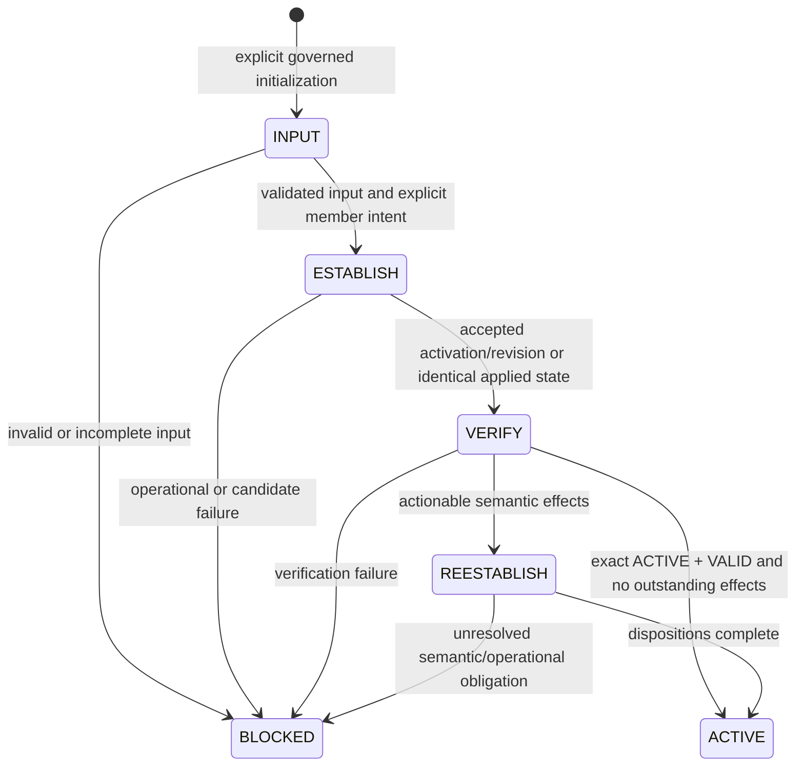
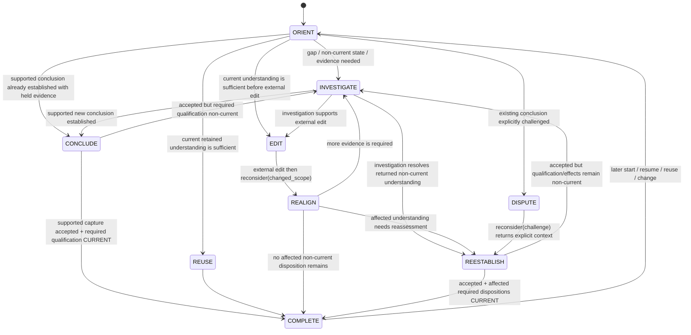

# Span lifecycle contract — layer 2

**Status: binding target for Span 1.0 Beta.** This is the second foundational layer, beneath the
[goals](goals.md) (layer 0) and layer 1 ([foundations](foundations.md)). Layer 1
states the axioms about the agent and the principles of the system. This layer
turns them into functional requirements: the operations that exist, what the
agent sends and receives, and what is deliberately not the agent's job. The
[functional design](functional-design.md) (layer 3) and the implementation
(layer 4) must be derivable from this document.

Authority and derivation between layers are defined in the
[requirements pyramid model](requirements-pyramid.md).

**1.0 Beta contract.** This document states the binding public lifecycle
requirements. Implementation and delivery conformance are evidenced separately
in [acceptance](acceptance.md); conformance evidence never changes this contract.

## 1. Position in the pyramid

This document owns Layer-2 public lifecycle requirements: operations, public
state/transitions, agent inputs/results, contract laws, and the agent/internal
boundary. The [requirements pyramid](requirements-pyramid.md) owns placement and
derivation; this layer references rather than restates Layers 0–1.

## 2. Terminology

| Term | Meaning |
| --- | --- |
| **Surface** | Defined in [foundations](foundations.md) §1. A **declared surface** (`SERVICE`, `DOMAIN`) has an explicit name and boundary. A **path surface** (`FILE`, `SYMBOL`) is identified by its path or canonical locator and is created on first reference, with no separate declaration step. |
| **Request identity** | The caller's stable identifier for one request that writes or issues a context. A retry reuses it; a new intentional act uses a new one. It carries no Span state and is not a token. A pure change-scope `reconsider` is a read and carries none. |
| **Boundary** | The paths or symbols that a surface covers. Used for discovery, change mapping, and the `unexamined` count. |
| **Granularity** | The kind of surface being asked about. The same question at file scope and at service scope is a different question with a different answer. |
| **Understanding** | The retained, versioned unit: one question over one surface, with supported conclusions. |
| **Answer** | What `ask` returns when usable understanding exists for the surface. |
| **Conclusion** | One supported statement inside an understanding. |
| **Curation state** | Reuse maturity of one exact semantic revision: `CAPTURED` until an explicit curation disposition exists for that revision, then `CURATED`. It is independent of support currency and governing authority. |
| **Curation disposition** | An immutable reviewer-authored acceptance of one exact conclusion revision for shared reuse, with non-empty reasoning and provenance. It does not change semantic content or governing authority. |
| **Evidence** | Exact source content — locator, range, content identity. |
| **Support** | The typed dependency of a conclusion on evidence, a discovery boundary, an authority, or another conclusion. |
| **Surface status** | The distribution over a surface's own conclusions and its boundary: current, stale, unassessed, and unexamined, with descendant status reported separately. |
| **Gap** | The absence of usable understanding, with its cause and the means to resolve it. |
| **Challenge** | An explicit dispute against a conclusion revision. |
| **Verification** | An independent run recorded against the observations or evidence actually tested. |
| **Functional Pyramid placement** | One canonical repository-qualified document reference declared at one pyramid layer, for one explicit directory scope in the declaring repository, with its declared governing placements. The document remains at its canonical source. |
| **Functional Pyramid** | The declared relationships from repository directories through applicable document placements to their governing document branches. |
| **Functional Pyramid instance** | One explicit, versioned set of registered repositories whose repository-owned declarations may resolve together. Membership makes cross-repository references reachable. Applicability follows from declarations. |
| **Functional Pyramid participation state** | Durable repository participation is exactly `UNCONFIGURED`, `EXCLUDED`, or `ACTIVE`. Only an accepted Functional Pyramid `record` changes it. |
| **Functional Pyramid health** | Live qualification of an ACTIVE pyramid: `VALID` or `DEGRADED`, computed from present declarations/member availability and never persisted by a hidden read-time transition. |
| **Functional Pyramid totality** | An ACTIVE member governs every directory in its repository. A mandatory repository-root-scoped P0 placement guarantees that every directory resolves to at least the foundational documents. Span reports declared and absent layers; it never returns an uncovered-path outcome and never invents documentation. |
| **Functional Pyramid view** | The governing projection for one directory or semantic scope: the applicable whole-document placements, the declared/absent layer summary and unresolved public findings. A truncated placement list is continued through the directory selector's `after` token. Governing edges, reverse dependencies, per-path provenance, internal findings and authority-binding payloads are internal resolution state, not part of this projection. |
| **Route support** | Server-derived support binding a normative conclusion to the exact Functional Pyramid route that applied when the conclusion was established. |

An understanding may be unsupported or captured-but-uncurated. An **Answer is
neither**: ordinary shared Answer content is both supported and curated.

## 3. The three public lifecycle operations

F6 fixes the lifecycle boundary and L8 fixes the public MCP surface: exactly
`ask`, `record`, and `reconsider`. Section 4 owns their public contract.

Repository installation/registration remains setup rather than another MCP
operation. General structural navigation remains host-owned. Functional Pyramid
orientation and participation are branches of the same lifecycle rather than a
parallel public API.

## 4. Public lifecycle operations

### 4.0 Answer boundary

State this before the operations, because everything else depends on it.

- Span answers from **retained, curated understanding scoped to a surface**. It
  does not synthesise an answer from first principles.
- A supported `CAPTURED` revision remains retained and auditable but is not
  ordinary Answer content. Pending curation is explicit state, never a warning
  attached to content the agent is expected to ignore.
- A first-contact question on an unassessed surface returns a **gap**, not a
  generated answer.
- When code changes, Span **marks containment and enumerates support loss, direct
  and indirect**; it never rewrites meaning. The answer is restored by the agent
  through `record`.
- Every answer reports the surface status. Status is never optional and never a
  single stamp.
- For an ACTIVE Functional Pyramid repository, ordinary current surface obtain also reports
  the Functional Pyramid view for the selected semantic scope. The view may be
  fully resolved while semantic understanding is a Gap, or unresolved while
  descriptive understanding remains usable.
- Governing route state never substitutes for semantic understanding, and
  semantic support never substitutes for governing applicability.

### 4.1 `ask` — obtain

Exactly one form is supplied:

| Form | Inputs | Effect |
| --- | --- | --- |
| Surface obtain | `repository_id` and exactly one of `surface` / `reference` | Read current grouped understanding and status; no request ID or context |
| Exact recorded-question obtain | `selector=RecordedQuestionSelector{repository_id, surface, question}` | Read current membership for that exact recorded question on that exact surface; no similarity matching, request ID or context |
| Explicit source admission | Surface obtain inputs, non-empty `evidence` selection and `request_id` | Admit selected sources/ranges into a recoverable evidence-only context |
| Exact current obtain | `selector=CurrentUnderstandingSelector{repository_id, understanding_id}` | Read that understanding's current membership with live support, curation and status |
| Pending curation | `selector=PendingCurationSelector{repository_id}` | Read a deterministic bounded set of current-membership semantic revision references that have no accepted curation disposition; no semantic ranking or mutation |
| Historical/audit obtain | `selector=UnderstandingSnapshotSelector{repository_id, understanding_id, version?}`, `ReceiptRetrievalSelector{repository_id, request_id}`, or `FunctionalPyramidReceiptSelector{request_id}` | Retrieve the exact snapshot or receipt in its owning namespace; never current-answer content |
| Functional Pyramid state | `selector=FunctionalPyramidSelector{repository_id? , pyramid_id?}`, exactly one identity | Read durable participation/instance state, current version/members and live health; no semantic conclusion is generated |
| Functional Pyramid directory lookup | `selector=FunctionalPyramidDirectorySelector{repository_id, directory, after?}` | Read the governing projection for a directory, including the repository root; `after` continues a truncated page; no semantic surface or mutation |
| Functional Pyramid candidate validation | `selector=FunctionalPyramidCandidateSelector{action="activate", members}` or `FunctionalPyramidCandidateSelector{action="revise", pyramid_id, expected_version, members}` | Purely validate the exact intended activation/revision against current registered repositories and repository-owned declarations; return complete public findings without mutation |
| Evidence continuation | `continuation` | Read the next selected-evidence page using its bound repository/request/context |

A surface is an exact `{kind, locator}` identity, never containment. A reference
must resolve to exactly one surface; otherwise return `AmbiguousSurface` with
exact candidates. Ordinary surface/reference obtain accepts no free `question`
field. Recorded questions remain metadata grouped in the document view, and F3's
targeted question reachability is the explicit
`RecordedQuestionSelector{repository_id, surface, question}`. The `surface` input in both ordinary obtain and this selector uses
`SurfaceReference`. In each form `repository_id: str` is the sole namespace; the surface
carries `kind` and `locator`; its optional nested `repository_id` must be absent
(including no explicit null). A nested repository input is a structural rejection,
not an override or a second matching rule. `question: str` is non-empty. The selector
matches the stored question exactly within the supplied surface; it performs no
normalisation, paraphrase matching, similarity search, or cross-surface lookup.
If no membership matches the exact recorded question, return `Gap/unassessed`,
not a separate
`no_match` reason. Exact selectors and continuation carry their own repository
binding; a separate repository override is forbidden. Unknown exact identities
have an explicit lookup rejection and public recovery, not an invented surface
or generated answer.

**Functional Pyramid obtain and candidate validation.** A
`FunctionalPyramidSelector` identifies exactly one registered repository or one
existing pyramid instance and returns its durable participation state and, for
ACTIVE participation, current live health.

`FunctionalPyramidDirectorySelector` resolves the Functional Pyramid for an
exact existing repository-relative directory. A directory value of `.` selects
the repository root. The result is `FunctionalPyramidView`,
`FunctionalPyramidParticipation` or `FunctionalPyramidUnavailable`. Invalid
paths or identities follow the ordinary exact-selector rejection.

A `FunctionalPyramidCandidateSelector` validates the exact intended write.
`action="activate"` carries the complete proposed member intents.
`action="revise"` additionally carries the target `pyramid_id` and
`expected_version`; validation therefore sees removals, current membership and
version conflicts instead of validating an anonymous replacement set. Each
member names its registered `repository_id` and its exact repository-owned
declaration source requests. It declares no member functional boundary:
participation is whole-repository.

Each member names its exact repository-owned declaration source requests. A
Version-3 declaration source carries its own `source_id`, kind (`repository` or
`area`), one normalized repository-relative directory `scope` (`.` for the sole
repository-kind source), its explicit whole-document membership set, and its
placements. Each placement carries the same scope as its containing source, plus
its canonical document reference, layer and governing placements. One canonical
document has exactly one placement in its declaring repository; a second
placement is a duplicate, not a second participation. Scope is explicit
declaration input; Span never infers it from document location, file names or
repository structure.

Candidate validation is pure. It resolves only the submitted member/declaration
sources and stable identities reached from them, validates the complete
placement graph, and requires at least one repository-root-scoped P0 placement
per member. It never enumerates the directory inventory to decide relevance,
never activates, repairs or copies governing content, and never grades
documentation completeness. The same candidate may be submitted later through
`record`; recording revalidates present source state rather than trusting an
earlier validation result.

**Pure obtain.** Surface/reference obtain returns all conclusions on that
surface that are both `CURRENT` and `CURATED`, grouped by recorded question,
with status, gaps, verification, limitations and explicit omissions. Current
CAPTURED revisions remain outside Answer content and are exposed through pending
status/references. For an ACTIVE Functional Pyramid repository, the same obtain resolves the
selected scope's declared Functional Pyramid and returns it as orientation state. An exact recorded-question selector first
restricts membership by surface and exact recorded question; a current selector
restricts membership to its returned understanding identity. Both then use the
same support/status owners as the grouped view. These pure forms create no
investigation context and require no caller request identity. A genuinely
unassessed surface or selected recorded question remains a Gap. Recovery
identifies the missing investigation and available source pointers as
`Gap.source_pointers: tuple[EvidenceRequest, ...]` without pretending they are
admitted observations or fingerprinted proof. The field is always present, empty
when no concrete source locator can be identified; it is not an admission result.
Each pointer has the existing EvidenceRequest locator/ranges shape. Omitted
pointers are named in Gap.omitted and its recovery; no directory is misrepresented
as an observed file. No source bodies are delivered unsolicited.

**Explicit evidence.** `evidence` is a non-empty selection of exact source
locators and ranges. Admission is restricted to the resolved surface and issued
scope. Whole-file requests are explicit. A valid selection returns the same
Answer/Gap classification plus one canonical `EvidenceAdmissionView` shared by
both result kinds. Its fields are `context: InvestigationContextRef`,
`outcomes: tuple[EvidenceAdmissionOutcome, ...]`,
`deliveries: tuple[EvidenceDelivery, ...]`, `continuation: str | None`,
`omitted: tuple[str, ...]`, and `truncated: bool`. It reuses the existing evidence request/outcome,
source-observation and range owners; it does not define parallel source-copy or
range shapes. `EvidenceDelivery` has exactly `observation_id: SourceObservationId`
and `unit: EvidenceUnit`. The unit carries the existing EvidenceRef, content,
content_fingerprint and content_range; the ID associates each whole/partial
delivery with its admitted observation. Immutable SourceObservation stores the
reference, content hash and delivered ranges, not the source bytes; delivery
re-reads and verifies the hash, and a continuation does not mutate the
observation to represent a page. For disjoint ranges, deliver separately positioned EvidenceUnit fragments
rather than labeling concatenated text as contiguous. Before admission, `EvidenceRequest` is the exact source-pointer
and selection carrier; after observation, `EvidenceRef` remains the canonical
observed/cited source identity inside `SourceObservation`. Each admission
outcome is tied to its request, and admitted/already-admitted outcomes name the
observation addressed by each delivery. Initial admission outcomes cover every
requested item in request order. Continuation pages use the same EvidenceDelivery
carrier in `EvidencePage.deliveries: tuple[EvidenceDelivery, ...]`; the other
EvidencePage fields are `continuation: str | None`, `omitted: tuple[str, ...]`
and `truncated: bool`. They do not repeat the full admission batch.
Source identities/ranges remain exact on every page. Missing, unreadable and
omitted sources remain explicit. Source or store failure is not semantic absence.
The request identity binds the complete selection; identical retries recover the
same context. Admission does not imply the agent read all selected bytes or
established meaning. The host owns structural navigation; Span never guesses
relevant symbols/ranges.

**Context reference.** A returned `context` is one canonical
`InvestigationContextRef{repository_id, context_id}`, emitted by its owning
persisted context. It is not an unqualified ID. Context-bound operations derive
routing from that reference and reject independent repository overrides. The
reference grants no authority; liveness, scope and membership are checked at the
owner. Pure obtains have no context. Context inspection remains internal/admin.

**Continuation.** A continuation binds repository, investigation context,
original request identity/digest and next evidence position. It introduces no
separate storage or retention lifecycle. Each page advances by at least one
unit or exact line range; an oversized unit splits at line boundaries. Omission
is explicit and recoverable. One line that cannot fit is refused explicitly.
Wrong binding, malformed or absent references return a typed rejection with
public recovery. Genuine operational access failure is Unavailable. A missing
row is not labeled expired or reaped without evidence. Identical continuation
replay against the same live context returns the same page across restart.

**The agent receives** exactly one of:

| Result | Meaning |
| --- | --- |
| `Answer` | Current supported and curated understanding for the selected membership |
| `Gap` | No conclusion eligible for shared reuse for the selected membership, with status and recovery |
| `PendingCuration` | Deterministic references to current-membership semantic revisions awaiting curation |
| `AmbiguousSurface` | A reference resolves to more than one exact surface |
| `RetrievedUnderstanding` | Exact historical/audit understanding retrieval |
| `RetrievedReceipt` | Exact immutable repository-scoped ordinary receipt retrieval |
| `RetrievedFunctionalPyramidReceipt` | Exact immutable installation-scoped Functional Pyramid receipt retrieval |
| `EvidencePage` | A continuation page for previously selected evidence |
| `FunctionalPyramidStatus` | Exact durable participation/instance state and live health for a Functional Pyramid selector |
| `FunctionalPyramidView` | Applicable document placements and the declared/absent layer summary for a directory or semantic-scope lookup |
| `FunctionalPyramidParticipation` | UNCONFIGURED or EXCLUDED participation for a directory lookup |
| `FunctionalPyramidUnavailable` | Operational inability to resolve the directory's governance |
| `FunctionalPyramidCandidate` | Pure action-aware ACTIVATE/REVISE validation with complete validation/graph findings and activation readiness |
| `Rejected` | An actionable invalid selector/reference/binding request |
| `Unavailable` | An operational failure that prevented evaluation |

Surface/current-understanding `Answer` and `Gap` carry
`functional_pyramid: FunctionalPyramidView | FunctionalPyramidUnavailable |
FunctionalPyramidParticipation`. A registered repository that has never been
configured returns `FunctionalPyramidParticipation(state=UNCONFIGURED)`; an
explicitly non-participating repository returns `state=EXCLUDED`. An ACTIVE
member returns a `FunctionalPyramidView` carrying its route status, applicable
documents and unresolved findings, or explicit operational unavailability. A
route's unresolved governance remains inside the view and is
not mislabeled as operational failure.

`FunctionalPyramidView` carries the pyramid identity/version, route
`status: RESOLVED | UNRESOLVED`, the requested directory or selected semantic
scope, all applicable whole-document placements, the declared/absent layer
summary and the unresolved findings. It does not carry governing edges, reverse
dependencies, per-path provenance or authority-binding payloads; those are
internal resolution state. A canonical document can be shared by branches
without duplicating a placement. A directory's result includes every placement
whose declared scope contains that directory, whether the scope is the directory
itself or an ancestor. A placement confined to another directory is included
only if it is an applicable ancestor placement or an applicable document
references it as governing.

The nested carriers are exact:

- `FunctionalDocumentRef` carries `repository_id: str`,
  `document_ref: str`, and
  `layer: P0 | P1 | P2S | P2W | P3 | P4`. `document_ref` is the normalized
  repository-relative whole-file locator of the canonical document. It resolves
  to exactly one `AuthorityBinding` for the same repository and locator, whose
  `EvidenceRef.section_or_span` is absent.
- `FunctionalDocumentPlacement` carries `declaring_repository_id: str`,
  `document: FunctionalDocumentRef`, and `scope: str`. `scope` is the
  normalized repository-relative directory in the declaring repository, with
  `.` as the repository root. The placement identity is the declaring
  repository, the canonical document reference, the layer and the scope. One
  canonical document occupies exactly one layer and one scope in its declaring
  repository; a repeated identity, a second layer or a second scope is a typed
  duplicate finding, not a second participation.
- `FunctionalDocumentRoute` is internal resolution state, not a public view
  field. It pairs one placement with its `authority`, `governing_placements` and
  `downstream_placements` for record-time authority support, directory
  resolution and reconsideration.
- `FunctionalRouteProvenance` is internal resolution state. It carries one exact
  selected directory or `EvidenceScope`, the applicable placement identities
  and, for a multi-path semantic scope, the path or boundary that selected them.
  It is not serialized into a public answer.
- `FunctionalPyramidView` carries exactly one selection. `directory` is set for
  directory lookup and `semantic_scope` is set for ordinary surface obtain.
  It also carries `placements`, `unresolved`, `declared_layers`, and
  `absent_layers`.

An unresolved finding identifies a repository plus the applicable placement or
whole-document coordinates. A structural finding without a placement still makes
an affected route `UNRESOLVED`: it is relevant when its declaring-repository
source scope contains a selected directory or semantic-scope portion, or when
the selected governing closure contains a placement in that repository under the
affected source scope. A route whose applicability is unrelated to the finding
remains `RESOLVED` even while global ACTIVE health is `DEGRADED`. Rule
identifiers and rule anchors are not part of any declaration, route, finding,
provenance or support carrier.

A reverse-dependency projection exists only for a selected canonical document
scope and is a separate selection; a directory or semantic-scope view never
exposes downstream placements. Every directory in an ACTIVE member resolves to
the declared placements whose scope contains it. A directory without a narrower
placement still resolves to its declared ancestor placements, including the
mandatory repository-root P0 placement; there is no empty-governance or
uncovered-path result. `RESOLVED` requires no structural unresolved relationship
in the returned route. `UNRESOLVED` requires at least one typed unresolved
relationship. Absent layers are reported, not treated as unresolved. The view
carries canonical references; governing relationships remain internal resolution
state. Substantive content remains in the canonical documents.

`FunctionalPyramidUnavailable` carries exactly non-empty
`failure: str` and `recovery: str` when the declared graph could not be
evaluated operationally. A descriptive Answer
may coexist with this state. A normative conclusion whose required route cannot
be evaluated is not CURRENT because route support is independently
`UNVERIFIABLE`.

**Functional Pyramid public carriers.** The lifecycle uses one canonical member
intent/view shape and one Functional Pyramid scope carrier; it does not add
parallel setup DTOs.

- `FunctionalPyramidMemberIntent` carries
  `repository_id: str` and
  `declaration_sources: tuple[EvidenceRequest, ...]` (non-empty).
- `FunctionalPyramidMemberView` carries
  `repository_id: str` and
  `declaration_refs: tuple[EvidenceRef, ...]`.
- `FunctionalPyramidParticipation` carries exactly
  `state: UNCONFIGURED | EXCLUDED`.
- `FunctionalPyramidParticipationEffect` carries
  `repository_id: str` and
  `state: UNCONFIGURED | EXCLUDED | ACTIVE`; it is the canonical per-repository
  durable effect of an accepted Functional Pyramid write.
- `FunctionalPyramidStatus` carries
  `state: UNCONFIGURED | EXCLUDED | ACTIVE`,
  `health: VALID | DEGRADED | None`,
  `pyramid_id: FunctionalPyramidId | None`,
  `version: FunctionalPyramidVersion | None`,
  `members: tuple[FunctionalPyramidMemberView, ...]`, and
  `findings: tuple[FunctionalPyramidPublicFinding, ...]`.
  Pyramid identity/version and members are absent/empty and health is `None`
  for UNCONFIGURED and EXCLUDED. ACTIVE always reports present live health.
  `health=VALID` requires `findings=()`; `health=DEGRADED` requires the
  non-empty current structural finding set that caused degradation.
- `FunctionalPyramidCandidate` carries
  the requested `action: ACTIVATE | REVISE`,
  target `pyramid_id/version` when revising,
  `members: tuple[FunctionalPyramidMemberView, ...]`,
  with `version=None` only when `UNKNOWN_PYRAMID` means no observed target
  version exists; stale revisions carry the observed current version in
  `version` and the requested/current pair in their validation finding,
  `activation_ready: bool`,
  `validation_findings: tuple[FunctionalPyramidValidationFinding, ...]`, and
  `graph_findings: tuple[FunctionalPyramidPublicFinding, ...]`.
- `FunctionalPyramidPublicReason` is exactly
  `DECLARATION_INVALID | DOCUMENT_SET_INCOMPLETE | DOCUMENT_UNAVAILABLE |
  DOCUMENT_AMBIGUOUS | GOVERNANCE_UNAVAILABLE | UNREGISTERED_MEMBER |
  DUPLICATE_MEMBER | MEMBER_ALREADY_ACTIVE | UNKNOWN_PYRAMID |
  STALE_PYRAMID_VERSION`. The fixed internal-to-public mapping is FD-88B.
- `FunctionalPyramidPublicFinding` carries
  `reason: FunctionalPyramidPublicReason`, optional `repository_id`, optional
  normalized `directory`, optional `placement: FunctionalDocumentPlacement`
  coordinates, plus non-empty `detail` and `recovery`. It never carries a
  `declaration_locator`, an internal reason enum, copied governing content,
  route, provenance or authority payload. Unused coordinates are absent.
- `FunctionalPyramidValidationFinding` carries
  `reason: FunctionalPyramidPublicReason` restricted to `DECLARATION_INVALID`
  and the five lifecycle reasons, optional `repository_id`, `pyramid_id`,
  `directory`, `expected_version`, and `current_version`, plus non-empty
  `detail` and `recovery`. It never carries `declaration_locator`.
  Unused coordinates are absent.
- The internal `FunctionalPyramidFinding`,
  `FunctionalPyramidFindingReason` and `FunctionalPyramidValidationReason` are
  server-side resolution carriers; they are never serialized.
- `FunctionalPyramidReceiptSelector` carries only `request_id` and addresses
  the installation-level Functional Pyramid write namespace.
- `RetrievedFunctionalPyramidReceipt` carries
  `request_id`, `content_digest`, `committed_at`,
  `action: ACTIVATE | REVISE | DEACTIVATE | EXCLUDE`,
  `pyramid_id: FunctionalPyramidId | None`,
  `version: FunctionalPyramidVersion | None`,
  `members: tuple[FunctionalPyramidMemberView, ...]`,
  `participation_effects: tuple[FunctionalPyramidParticipationEffect, ...]`,
  and `dependent_effect_refs: tuple[ConclusionRevisionRef, ...]`.
  It has no investigation-context binding or repository receipt owner. For
  ACTIVATE/REVISE, `members` is the resulting ACTIVE member set. For
  DEACTIVATE/EXCLUDE it is empty. The effects tuple records every repository
  whose durable participation changed.

**Beta-3 curation carriers.** The public curation grammar is exact:

- `CurationState = CAPTURED | CURATED` is a derived reuse-maturity projection;
  it is never a substitute for `SupportState`.
- `CurateConclusion` carries exactly
  `conclusion_id: ConclusionId` and non-empty `reasoning: str`.
- `PendingCurationSelector` carries
  `repository_id: str` and optional
  `after: ConclusionRevisionRef | None`. Pending order is the ascending tuple
  `(understanding_id, conclusion_id, revision)`; `after` is an exact
  keyset cursor, not an opaque semantic ranking token.
- `PendingCurationItem` carries exactly
  `ref: ConclusionRevisionRef`,
  `understanding_version: UnderstandingVersionNumber`,
  `surface: SurfaceKey`, and
  `question: str`. It never copies the conclusion statement.
- `PendingCuration` carries
  `repository_id: str`,
  `items: tuple[PendingCurationItem, ...]`,
  `next_after: ConclusionRevisionRef | None`,
  `omitted: tuple[str, ...]`, and
  `truncated: bool`. When truncated, `next_after` is the last returned
  item's exact revision ref; otherwise it is absent.
- historical/current exact understanding retrieval carries the immutable
  curation dispositions applicable to that snapshot so audit can distinguish
  capture from later curation without reading storage internals.

`PendingCuration` is an `AskResult`; it is pure/read-only and has no request
identity or investigation context. The selector admits only current-membership
CAPTURED revisions whose live required support is `CURRENT`. Captured revisions
with non-current support follow the existing stale/re-establishment path and
become pending only after support is re-established. *(F2, F13, L2, L17)*

Malformed selector structure is `Rejected`, not a validation finding.
`MEMBER_ALREADY_ACTIVE` means ACTIVE in a different pyramid; a retained member
of the target REVISE pyramid is valid. Operational inability to evaluate an
otherwise valid candidate is `Unavailable`.
`activation_ready=true` requires empty validation findings and no structurally
unresolved graph finding in the candidate declarations. An ancestor-scoped
placement covering a directory without a narrower placement is normal
declaration practice, not a candidate graph finding or activation blocker.
Authority status/content currency is not a candidate-graph condition
and therefore does not prevent structural activation.

`FunctionalPyramidId` and `FunctionalPyramidVersion` are opaque server-owned
identities. `FunctionalPyramidReceiptSelector{request_id}` is the installation-
local audit/replay selector for Functional Pyramid writes. It deliberately has no
repository coordinate because activation/revision can atomically own several
repositories. Candidate validation returns no reusable authority or commit token;
a later record revalidates current declaration source state.

Answer carries only CURRENT + CURATED statements, nature, scope,
per-conclusion support, evidence references, surface status and applicable
verification. Gap carries status, cause
(invalidated/unverifiable/unassessed/pending_curation), changed evidence,
historical content, pending references, missing items and actionable recovery. `Answer.admission` and
`Gap.admission` are absent unless explicit evidence admission ran; when present
they contain the one shared `EvidenceAdmissionView` above. All bounded results
preserve omission and recovery. Historical retrieval includes live support
qualification of the exact revisions but is never served as Answer. Compact
qualification and audit retrieval follow §4.2; no evidence is invented merely
to populate a cheap result. *(L1–L3, L7, L9, L11)*

A `Gap`'s `historical` list is historical **content**, not a pointer: each entry
carries the exact conclusion revision, the understanding version that holds it,
the statement, the evidence references it cites, and the present non-current
state that made it historical. It stays structurally separate from
`conclusions`; historical content never becomes current answer content. The list
is bounded with the rest of the response, and a truncated list names what was
omitted and the snapshot retrieval path (FD-54–FD-57). *(L2, L3)*

**Surface status** is a distribution, not a verdict:

| Component | Meaning |
| --- | --- |
| `current` | conclusions in this surface that are both CURATED and supported by present dependencies |
| `pending` | CURRENT-support, current-membership CAPTURED conclusions; counted and returned as `pending_refs`, never as answer content |
| `stale` | conclusions whose support no longer holds, directly or through a premise; counted and returned as `stale_refs`, never as answer content |
| `unassessed` | recorded gaps or declared questions with no supported conclusion |
| `unexamined` | boundary members with no understanding at all; computed from the boundary and reported with explicit enumeration limits (F9) |
| `descendants` | status of contained surfaces, summarised separately |

A parent surface's own conclusions are its own; descendant status is reported
alongside and never merged into the parent answer. That is what makes a domain
honestly reportable while it still holds both current and stale understanding.

`pending_refs` names each CURRENT-support, current-membership CAPTURED
conclusion by exact revision identity and owning understanding version.
CAPTURED conclusions with non-current support are stale, not simultaneously
pending. `stale_refs` names each non-current conclusion by exact revision
identity, the understanding version
that holds it, and its present non-current support state
(`REASSESSMENT_REQUIRED` or `UNVERIFIABLE`). Each count and reference set
describes the same population; pending or stale references are never Answer
content. Descendant statuses carry
their own references; they are never merged into the parent. A reference is not
answer content: to read the statement, `ask` with
`UnderstandingSnapshotSelector{understanding_id, version}`. The status never
auto-withdraws or auto-corrects a conclusion (FD-23, FD-35, FD-36). *(L2, L9)*


### 4.2 `record` — retain

```text
record(kind="understanding", conclusion, locator|observation_id|support, surface?, question?|context)
record(kind="understanding", understanding_id, expected_version, actions)
record(kind="verification", run)
record(kind="surface", action="create"|"update", surface)
record(kind="functional_pyramid", request_id, action="activate", members)
record(kind="functional_pyramid", request_id, action="revise", pyramid_id, expected_version, members)
record(kind="functional_pyramid", request_id, action="deactivate", pyramid_id, expected_version)
record(kind="functional_pyramid", request_id, action="exclude", repository_id)
```

`kind` selects the record kind. It is not a tool variant. For understanding,
a first version is the flat create above. An update carries `actions`, an object
whose keys are `add`, `confirm`, `correct`, `replace`, `withdraw`, `curate`.
Semantic mutation keys may be combined under their existing atomic rules;
`curate` is a separate reuse-qualification act and may not be combined with
`add`, `confirm`, `correct`, `replace` or `withdraw` in the same update. The agent never selects a separate record tool, and
`create` is not an action: the flat create form is the only first-version path.

**Functional Pyramid recording.** This record kind changes only Span's
Functional Pyramid participation/binding state; it never edits repository
sources. It is installation-scoped rather than repository-scoped because one
accepted write may change several member repositories atomically.
`request_id` is keyed within the Functional Pyramid write namespace: same
request identity + same canonical content is replay; same identity + different
content is conflict. Accepted writes return
`FunctionalPyramidReceiptSelector{request_id}`; ordinary repository-scoped
recording and `ReceiptRetrievalSelector{repository_id, request_id}` are
unchanged.

`members` is the same canonical member-intent shape used by candidate
validation: registered repository identity and exact declaration source
requests. A declaration source request denotes one complete declaration
document; a non-empty `EvidenceRequest.ranges` selection is partial and
therefore invalid for Functional Pyramid declaration validation.

- `activate` creates one new pyramid instance from UNCONFIGURED/EXCLUDED
  repositories after revalidating every member and declaration.
- `revise` compare-and-sets one existing instance version and atomically
  replaces its complete member intent. Repositories removed by an accepted
  revision become UNCONFIGURED; removal does not invent an explicit
  non-participation decision.
- `deactivate` compare-and-sets an existing instance and makes all of its
  members EXCLUDED.
- `exclude` records explicit non-participation for one repository that is not a
  member of an ACTIVE instance.

Activation/revision accepts only a candidate that would return
`activation_ready=true` under the corresponding action-aware candidate
selector: member identity/uniqueness, declaration sources, document placement
identity, governing edges, repository bindings and the repository-root P0
invariant must validate. A failed candidate changes no durable state. One
repository may not be ACTIVE in another Functional Pyramid instance.

Participation is whole-repository. There is no member coverage mode and no
member functional boundary. A member may rely on ancestor-scoped placements for
any directory; that is normal declaration practice, not an incomplete state.
`activation_ready` requires at least one repository-root-scoped P0 placement
whose governing relationship is `ROOT`, which makes directory resolution total.
Span does not enumerate directories to establish relevance. Absent layers at a
selected directory are reported by the view; they do not change activation
readiness, route status or health. Documentation existence and quality remain
the declaring owner's responsibility. Authority status/content currency is
evaluated by authority support and is not folded into graph topology.
Recording retains references/identities/relationships and source identities, not
canonical document content.

The accepted result is `FunctionalPyramidRecorded`, carrying the receipt,
resulting ACTIVE member set, exact per-repository durable participation effects,
`dependent_effects: tuple[ChangedSurface, ...]`, and
`reestablishment_contexts: tuple[InvestigationContextRef, ...]`. The dependent
effects use the same canonical affected-surface/conclusion projection as
`reconsider`; no Functional-Pyramid-specific duplicate shape exists. Exactly one
repository-bound re-establishment context is returned for each repository with
an actionable dependent effect. Candidate findings remain owned by
`FunctionalPyramidCandidate`; a successful write has already revalidated
`activation_ready=true` and does not duplicate empty validation projections.

ACTIVATE/REVISE carry the live pyramid identity/resulting version. DEACTIVATE
retains the affected pyramid identity and the deactivated version in the
acceptance/receipt for audit even though no live instance remains. EXCLUDE carries
no pyramid identity/version. ACTIVATE/REVISE/DEACTIVATE derive semantic dependent
effects from the participation/route change before the acceptance transaction is
committed; EXCLUDE has no active-instance route effects. The immutable receipt
retains the accepted durable participation effects and
`dependent_effect_refs: tuple[ConclusionRevisionRef, ...]`. A replay never
changes or expands that accepted identity set. Its returned
`dependent_effects: tuple[ChangedSurface, ...]` is a live projection obtained
by re-evaluating only those retained refs against current support/membership
state; revisions that are no longer actionable are omitted from the live
projection, and fresh repository-bound contexts are issued only for effects that
are actionable now. It is receipted/replay-safe under L4. The server
derives the pyramid identity on first activation; callers never choose a stable
internal identity.

**Surface declaration.** A declared surface (`SERVICE`, `DOMAIN`) carries a
stable name, a boundary, and an optional parent; its identity is the declared
name, so the boundary may evolve without losing its understanding. A path
surface (`FILE`, `SYMBOL`) needs no declaration: it is identified by the path or
canonical locator and is created on first reference.

`record(kind="surface", action="create")` declares a service or domain with a
boundary and optional parent. `action="update"` requires
`expected_boundary_version` and advances exactly one boundary version. A
declared surface must exist before an understanding is recorded against it;
the service never auto-declares a surface from an understanding. The result is
`SurfaceDeclared` with the stored surface and its boundary version.

A parent must be an existing declared surface in the same repository;
self-parent and cycles are rejected. A `create` with a changed boundary under an
existing version is a `Rejected` conflict; an `update` with a stale
`expected_boundary_version` is a `Rejected` naming the current boundary version,
not `Unavailable`. *(A2, A8, L4)*

**Understanding request** carries one conclusion, the evidence that supports it,
the question or the context that binds the target, the surface or the scope
that derives it, and any gaps. A create names exactly one evidence mode —
`locator`, `observation_id`, or non-empty `support` — where `support` is the
complete caller-supplied dependency set the agent already holds. Server-derived
normative governance dependencies are added independently under F11/L12. A locator may
accompany explicit support as the carried code scope, but an observation id may
not: it would be ignored by the dependency set. A create's scope is supplied or
derived independently of its evidence mode, from explicit `scope_paths`, the
bound context, or a single carried path; a multi-file conclusion names its
owning surface and supplies its scope, or uses a context that binds that scope.
An update carries the expected
version and the action set instead. A create is one conclusion; a second
conclusion is a second request. *(F5, F7, L7)*

A create may supply the admitting `context` reference. A persisted question-origin
context binds the target; supplying `question` or non-empty `scope_paths` as well
is a Rejected conflict, not an override. New explicit ask admission is evidence-only:
its context does not supply the semantic question or independently determine an
owner. Such creates supply question and semantic scope through the declared
direct inputs. Without a supplied context, Span derives its operational context
from those inputs and complete support requirements. *(F7, L7)*

A create may also omit `surface`. Span derives it from the scope the request
already carries: the question context's bound scope when a context is supplied,
otherwise the effective scope derived from `scope_paths`, a direct locator, or
an explicit FILE surface. If the carried scope names more than one
path, the create is `Rejected` with the candidate surfaces. When the agent does
supply a surface, every semantic member must agree with that owner; a mismatch
is `Rejected`. FILE/SYMBOL agreement follows path-surface membership (FD-5),
not the presence of just one matching member.
*(F7, L7)*

Semantic scope describes what the conclusion is about; support identifies what
established it. Multiple support files do not create additional owning surfaces.

For `assertion_nature=NORMATIVE` in an ACTIVE Functional Pyramid member, the
caller's support is not the complete governance dependency set. Span resolves
the effective semantic scope through the Functional Pyramid and derives one
route support dependency plus authority support for every applicable canonical
document. The caller cannot suppress, replace or narrow those server-derived
governance dependencies.

An unresolved route or presently unsupported applicable authority is **not an
input rejection merely because it is non-current governance**. If the semantic
record request is otherwise valid, Span retains the new/revised conclusion and
returns its live qualification as `UNVERIFIABLE` or
`REASSESSMENT_REQUIRED` under the owning support rules. F2 then prevents that
revision from appearing as CURRENT Answer content. Structural request defects,
invalid evidence/context, stale semantic CAS and other ordinary recording
violations remain rejections. Explicit caller support may still include
additional empirical, premise, discovery or external authority dependencies that
are not substitutes for the derived route.

For `DESCRIPTIVE` conclusions, Functional Pyramid state is returned as
orientation but is not automatically a support dependency. An investigator may
still cite explicit authority where the descriptive conclusion genuinely
depends on it.

Span has exactly two assertion natures: `DESCRIPTIVE` and `NORMATIVE`. A
conformance judgment is represented as a NORMATIVE conclusion; there is no third
`CONFORMANCE` assertion nature. Consequently every conformance judgment in an
ACTIVE Functional Pyramid repository receives the same server-derived
route/authority support as any other NORMATIVE conclusion.

The effective semantic scope is a complete `EvidenceScope`: paths, exact evidence
references, or an empty scope denoting the whole repository. A supplied
SERVICE/DOMAIN must already exist and contain the complete semantic scope.

**Recording contexts.** A supplied context retains its complete issued scope.
New source evidence may be admitted inside it; a newly cited discovery boundary
must be wholly contained by it. Evidence membership may grow, but scope never
widens. A supplied `context` is the bound reference defined in §4.1; the
context-bound branch forbids a separate repository override. Direct-evidence
branches carry their repository explicitly. The same alternatives apply to
verification, update and challenge inputs that use admitted observations.
When investigation expands, omit `context` and provide direct
scope/evidence. Span derives an evidence-only operational context sufficient for
all required evidence, including repository-wide discovery when cited. This
operational scope never replaces the semantic scope of an understanding.
Admitted evidence references and observation IDs remain context-bound; supply
the admitting context or express dependencies through direct evidence.

**Request identity.** Every write and explicit source-admission request carries
the caller's request identity. Retained receipt resolution precedes context
issuance, evidence admission, and command construction. Ordinary semantic,
verification, surface and challenge recording use the existing
`repository_id + request_id` namespace. Functional Pyramid recording uses the
distinct installation-level Functional Pyramid namespace because one write may
atomically change several repositories and no member is an artificial owner.

Within either namespace, the same request identity with the same canonical
content is a replay; the same identity with different content is a conflict; a
new identity with identical content is a new intentional act.
Across a grammar upgrade, retained accepted ordinary receipts remain retrievable
by their original repository/request identity and Functional Pyramid receipts by
their original `FunctionalPyramidReceiptSelector{request_id}` for their promised
retention period. A new
grammar does not authorize translating a historical write into another write or
blindly repeating it. Recover the accepted outcome first; old input acceptance
and immutable history retrieval are different promises.

| Action | Meaning |
| --- | --- |
| `add` | add a conclusion lineage while retaining the rest of the membership |
| `confirm` | the same conclusions still hold after substantive reassessment |
| `correct` | a conclusion's content changes; a new revision is created |
| `replace` | one conclusion is superseded by another |
| `withdraw` | a conclusion is retracted, with its basis |
| `curate` | accept the exact current semantic revision for shared reuse, with non-empty reviewer reasoning; semantic content and support are unchanged |

Update actions are compact deltas, not full conclusion snapshots.
The caller supplies semantic intent and evidence it already holds; Span derives
new conclusion lineage identities and all mechanical bookkeeping. `add` carries
`conclusion`; `confirm`, `correct`, `replace`, and `withdraw` carry the existing
`conclusion_id` returned by Span. `correct` also carries `conclusion`;
`replace` carries `conclusion` and `reason`; `withdraw` carries `reason`. No
action accepts a caller-created new lineage identity, and `replace` has no
`new_conclusion_id`. Every action that supplies evidence names exactly one
evidence mode: `locator`, `observation_id`, or non-empty `support`; `withdraw`
may supply one or none. Span derives the old revision identity, any unchanged
assertion nature or scope, the mechanical basis, and the submission digest.
`expected_version` stays mandatory and compare-and-set. *(F5, F7, F13, L4, L7)*

**Curation.** A `curate` action supplies one or more
`CurateConclusion{conclusion_id, reasoning}` values. Span resolves each exact
current revision from the expected understanding version, evaluates its required
support, and accepts curation only when that support is presently `CURRENT`.
A non-current target is a typed `Rejected/validation` requiring
re-establishment before review can be accepted. Span then records one immutable
curation disposition per exact revision. The action does not change statement,
assertion nature, semantic scope, support or Functional Pyramid state. It
advances the understanding version so history shows when each exact semantic
revision became eligible for shared reuse.

Create, add, correct and replace produce CAPTURED semantic revisions. A
support-only confirm of semantically unchanged meaning preserves prior curation
when the confirmed predecessor was CURATED; confirm of a CAPTURED revision
remains CAPTURED. Withdrawal is never reusable. If curation review finds the
meaning wrong, incomplete, duplicated or wrongly scoped, the reviewer uses the
existing challenge/correct/replace/withdraw lifecycle first and curates only the
resulting stable revision. Curation is reviewer judgment, not support evidence,
authority or semantic truth certification. *(A10, F2, F5, F13)*

**Challenge dispositions.** An understanding update may settle a named challenge
in the same atomic `record`. An unresolved disposition carries exactly
`challenge_id`, `expected_challenge_revision`, `remaining_question`, and
`basis`. A resolved disposition carries exactly `challenge_id`,
`expected_challenge_revision`, `reasoning`, optional `target_conclusion_ids`,
and optional `evidence_refs`. `target_conclusion_ids` are semantic lineage
identities already returned by Span; they never contain a version or revision.
When omitted, the targets are the challenge's own target lineages. A target may
name a challenged lineage being replaced by an action in this same request;
Span follows that explicit replacement effect to the server-derived replacement
lineage. Every resolved target must identify exactly one conclusion effect or
current resulting member in the resulting understanding. Span derives the
resulting understanding/version and exact resulting revision references,
classifying a resulting `WithdrawnConclusion` under `withdrawn` and every other
resulting target under `conclusions`. A caller never predicts an identity,
version, or revision created by the same request.

`evidence_refs` are optional opaque evidence handles already admitted in the
recording context. New source evidence that supports the resulting conclusion is
supplied through that conclusion action's ordinary evidence mode and therefore
participates in the context-free recording path; the resolved disposition may
omit `evidence_refs` in that case. Evidence used only for disposition reasoning
must already be admitted in the supplied context. There is no portable evidence
handle and no separate disposition-admission operation. Challenge settlement,
conclusion effects, and the receipt commit atomically; any invalid target,
challenge revision, or evidence membership rejects the whole write. *(F5, F7,
L4, L7)*

A first version is not an action. It is the flat create
(`conclusion`, one of `locator`, `observation_id`, or `support`, and the target)
stated above. The caller does not supply a conclusion identity; Span derives the
first lineage identity. *(F7, L7)*

**Structural grammar.** Kind/action selection, field presence, evidence-mode
exclusion and syntactic target/scope inputs have one canonical typed declaration
used by decoding and advertised schema projection. Null, omitted, empty and
unknown fields have the same meaning at both boundaries. Stateful context origin,
liveness/membership, surface containment and version checks remain with their
canonical runtime owners. Conflicting structural inputs are rejected before
admission, with all independently determinable conflicts and corrective fields;
validation never continues source work merely to collect more errors.

Omission is not deletion. Withdrawal is explicit, and history is preserved.

Evidence arrives in whichever form the agent already has it:

- locators and ranges it just read — Span re-reads and fingerprints them, or
- the bound `context` from explicit ask admission or a challenge — Span reuses
  its admitted evidence. Pure obtain/change analysis never implies admission.

Discovery support follows the same rule: the agent declares the boundary it
inspected and Span derives the observation, or it supplies a discovery
observation from a preceding answer. There is no separate discovery admission
call.

**Verification scope.** A recorded run applies to the surfaces **within** its
declared scope: a run scope path covers a surface path when it is equal or an
ancestor. It is returned in an answer for those surfaces and is not widened by
a broader question; a single-file run does not apply to a broader service.
Record the run against the surface it actually verifies. A run requires
at least one observation or evidence item; both may coexist. Observations require
their admitting context. Direct evidence may be newly admitted inside a supplied
context, or recorded without one against explicit run scope/evidence. *(A8, F4)*

There is no separate evidence-admission call. This is F7's test: recording
requires nothing the agent does not already hold.

**The agent receives** exactly one of `UnderstandingRecorded`,
`VerificationRecorded`, `SurfaceDeclared`, or
`FunctionalPyramidRecorded` for the requested `kind`, or `Rejected`, or
`Unavailable`. An ordinary acceptance carries its exact receipt selector, accepted
subject coordinates, live qualification and the status required by its result
kind — or a rejection naming the exact offending identity, the exact
cause, the structured current version or current boundary version when one
exists, and the required action. For `UnderstandingRecorded`, live qualification
and owning `SurfaceStatus` are
composed after acceptance. Expected operational failure is represented by
`SupportUnavailable` or `SurfaceStatusUnavailable` while preserving the accepted
effect and its receipt selector. The full immutable receipt stays in storage;
status is never persisted in it. A rejection's `cause` and
`required_action` are server-owned public contract text derived from its typed
cause and structured public coordinates; they are never copied from raw
exception text.

**Compact public acceptance and exact detail.** The ordinary acceptance carriers
are fixed before implementation:

The following are complete field sets for ordinary understanding/verification
acceptance. Existing identity, enum and reference types retain their canonical
validation; every timestamp is timezone-aware. No unlisted field is inferred.

| Result | Exact public fields |
| --- | --- |
| `UnderstandingRecorded` | `receipt_selector: ReceiptRetrievalSelector`, `committed_at: datetime`, `understanding_id: UnderstandingId`, `version: UnderstandingVersionNumber`, `affected_revisions: tuple[ConclusionRevisionRef, ...]`, `dependent_effects: tuple[ConclusionRevisionRef, ...]`, `qualification: UnderstandingQualification \| SupportUnavailable`, `status: SurfaceStatus \| SurfaceStatusUnavailable` |
| `VerificationRecorded` | `receipt_selector: ReceiptRetrievalSelector`, `committed_at: datetime`, `run_id: VerificationRunId`, `command: str \| None`, `scenario: str \| None`, `outcome: VerificationOutcome`, `qualification: VerificationQualification \| SupportUnavailable` |
| `FunctionalPyramidRecorded` | `receipt_selector: FunctionalPyramidReceiptSelector`, `committed_at: datetime`, `action: ACTIVATE | REVISE | DEACTIVATE | EXCLUDE`, `pyramid_id: FunctionalPyramidId | None`, `version: FunctionalPyramidVersion | None`, `members: tuple[FunctionalPyramidMemberView, ...]`, `participation_effects: tuple[FunctionalPyramidParticipationEffect, ...]`, `dependent_effects: tuple[ChangedSurface, ...]`, `reestablishment_contexts: tuple[InvestigationContextRef, ...]` |

The receipt selector is the only enclosing request coordinate for its owning
namespace. Ordinary semantic/verification receipts remain repository-scoped;
Functional Pyramid receipts are installation-scoped. No result nests
RecordReceipt. Affected revisions identify this acceptance's
conclusion effects; dependent_effects reference other affected lineages. They
are explicit even when empty. Verification command/scenario retain the run's
existing at-least-one-present rule; the immutable recorded outcome is distinct
from the present support state in qualification.

**Public qualification projections.** These are the sole compact projections
for the named public positions; they do not replace internal/detailed support
carriers or introduce another evaluator. Required tuple fields may be empty;
non-current findings and material limitations must never be silently omitted.

| Carrier | Exact fields |
| --- | --- |
| `SupportQualification` | `state: SupportState`, `observed_at: datetime`, `reason: str`, `limitations: tuple[str, ...]`, `findings: tuple[DependencyFinding, ...]` |
| `ConclusionQualification` | `ref: ConclusionRevisionRef`, `evaluation: SupportQualification` |
| `ObservationQualification` | `observation_id: SourceObservationId`, `evaluation: SupportQualification` |
| `UnderstandingQualification` | `state: SupportState`, `observed_at: datetime`, `limitations: tuple[str, ...]`, `conclusions: tuple[ConclusionQualification, ...]` |
| `VerificationQualification` | `state: SupportState`, `observed_at: datetime`, `limitations: tuple[str, ...]`, `observations: tuple[ObservationQualification, ...]` |

UnderstandingQualification contains no understanding_id/version; those belong
to UnderstandingRecorded or the containing answer membership. VerificationQualification
contains no run, run_id, command, scenario or outcome; those belong to its
containing acceptance/verification view. Exact conclusion/dependency references
remain where they address a distinct qualified unit or relation; that is not a
second copy of enclosing subject metadata. SupportQualification contains all
non-CURRENT dependency findings, not a repeated full dependencies array. Full
dependency sets remain accessible in exact audit retrieval. The qualified subject must match its containing exact subject/revision; compact
projection cannot discard a mismatched internal identity to make it appear valid.
Operational inability to qualify is SupportUnavailable, never a manufactured
support verdict or time.

For current Answer content, ConclusionView owns one ref and its
`support: SupportQualification`; Answer eligibility itself proves that exact
revision is CURATED, so the view does not repeat a constant curation flag.
Pending-curation projections use exact revision references and never masquerade
as ConclusionView Answer content.
VerificationView owns the existing canonical `run: VerificationRun` once and
`qualification: VerificationQualification | SupportUnavailable`. Thus both
current answers and ordinary acceptances use the same compact qualification
contracts without repeating a run body inside qualification. Detailed snapshot
retrieval retains its full existing UnderstandingSupport and dependency carriers.

Unavailable post-commit qualification/status preserves the accepted effect.

Repository-scoped `ReceiptRetrievalSelector` retrieves the existing full
immutable ordinary acceptance, digest, context binding and replay details. For
verification receipts,
`RetrievedReceipt.verification_runs: tuple[VerificationRun, ...]` returns exactly
the immutable runs named by the receipt; it is empty for ordinary receipts with
no accepted runs. Runs are read from their existing owner, not reconstructed
from qualification. A missing referenced run is explicit unavailable history,
never an empty successful detail response.

`FunctionalPyramidReceiptSelector` returns
`RetrievedFunctionalPyramidReceipt` from the installation-level namespace with
the exact fields defined above. It has no investigation-context binding and does
not masquerade as an ordinary repository receipt.

The snapshot selector with the exact accepted understanding/version retrieves
revisions/dependencies and their live qualification, with evaluation time.
Neither historical retrieval becomes Answer content. Omission remains explicit
and recoverable; compact output is not permission to drop audit state.


### 4.3 `reconsider` — re-align

```text
reconsider(changed_scope, since?)
reconsider(challenge, understanding_ref, conclusions, reason, evidence)
```

**`changed_scope`** takes the paths the agent just edited, or exact surfaces.
It is an after-edit operation, not a before-edit planning call. Before editing,
use `ask` for current understanding. The result includes every surface that must
be re-examined or repaired, and says why it appears:

- every surface whose boundary contains the change — **containment**;
- every surface that owns a conclusion with direct source, discovery,
  authority or Functional Pyramid route support loss — **direct**;
- every surface that owns a conclusion with indirect support loss, including a
  surface whose boundary does not contain the change — **indirect**.

Discovery dependents are part of the direct set: a changed path maps to every
discovery observation whose scope contains it, and the conclusions supported by
those observations are included before the premise walk.

Functional Pyramid dependents are likewise part of the direct set. A change to a
participating placement declaration, document declaration, canonical authority source,
accepted status, governing edge, member availability or active pyramid
membership causes Span to re-resolve the affected route dependencies. The walk
uses the complete Functional Pyramid instance, so a governance change in one
repository may directly affect normative understanding owned by another member
repository. A changed route or authority is reported as direct support loss for
the normative conclusions that depended on it; premise propagation remains
indirect. Implementation source need not change for governance-driven
reassessment to be required. The result groups affected surfaces by their owning
repository while preserving one change analysis; the caller is not required to
predict cross-repository dependents.

For each included surface:

- the affected conclusions, each with its own support state,
- the checked differences,
- the dependency effects, including descendant effects,
- the current evidence,
- the reason or reasons it appears,
- and exact update coordinates/source references for re-establishment.

A surface can appear for more than one reason, and the reasons are never
collapsed into one "stale" set. Reasons mean **considered**, not stale: a
conclusion may be included because its surface was considered and still be
`CURRENT`. Only `REASSESSMENT_REQUIRED` and `UNVERIFIABLE` mean actual loss and
require re-establishment. Inclusion is not limited to containment: as F4
requires, a conclusion in one surface can depend on a conclusion in another, and
its owning surface must appear even when the changed file is outside its
boundary.

When `since` is absent, the comparison is present source against each recorded
observation's identity. That is the default and needs no caller input.
Change-scope reconsider requires no caller request identity, but F4 requires
bounded re-establishment context for every affected repository. Span therefore
returns `reestablishment_contexts: tuple[InvestigationContextRef, ...]` with
exactly one live context for each repository that owns at least one actionable
affected conclusion. The context's existing `repository_id` is the mapping key;
the tuple is deterministically ordered by repository identity. A single-repository
change remains the degenerate one-context case. No multi-repository investigation
context is introduced.

Repeating the same changed paths is a new read and must return current change
analysis with fresh usable per-repository contexts even when prior contexts have
expired; this does not renew or lengthen those prior contexts.
Re-establishment in each repository may use that repository's returned context
with the returned update version, or use direct evidence when the investigation
no longer fits that context.

**`challenge`** raises an explicit dispute and returns the prior answer, the
evidence, and a context. Challenges are raised here and settled through `record`
with named dispositions. They never settle implicitly, and a matching
fingerprint never settles one.
The context is the canonical bound reference from §4.1. Challenge is a write
with stable request identity; a supplied context determines routing, without an
independent repository override. Direct challenge evidence derives its context
internally. This write branch is distinct from pure change-scope reconsider.

Results are a closed union: `Changed`, `Challenged`, `Rejected`, `Unavailable`.
`Changed` is keyed by surface; each entry carries its reasons (`containment`,
`direct`, `indirect`) and its affected conclusions with per-conclusion support
state. The result also carries the bounded
`reestablishment_contexts: tuple[InvestigationContextRef, ...]` required by
F4, exactly one for each repository with actionable affected conclusions. Each affected conclusion carries the understanding's
current `expected_version`, so a continuation into `record` needs no
intervening `ask`; only a conclusion in current membership is returned as
actionable, while historical revisions remain traversable as dependencies.
`Challenged` carries the challenge and its derived context; challenges are
settled through `record` with named dispositions.


## 5. The internal boundary

Everything in this table exists. None of it is the agent's job. The right-hand
column is the law that forces it inward.

| Internal | Why it is not public |
| --- | --- |
| Context issuance mechanics | Span owns issuance keys, origin and binding; when continuation/re-establishment needs context, the agent receives only the opaque `InvestigationContextRef` (F7) |
| Evidence admission | a step inside `ask`/`record`/`reconsider`, not a task (F7) |
| Observation identity generation | derived by Span from source; any returned observation identifier is only an opaque contract handle (A5, F7) |
| Submission identity | derived from the caller's request identity and content; receipts make retry safe (A2, F7) |
| Support evaluation | an attribute of every returned answer (F2, F6) |
| Surface status computation | an attribute of every returned answer (F9) |
| Retrieval by reference | no separate operation; exact snapshots and receipts fold into `ask`, and context inspection remains internal/admin (F6) |
| Exact understanding membership and surface document view | inside `ask` (F6) |
| Challenge persistence | `reconsider` raises; `record` settles (F5, F6) |
| Status, digest, notices | host-surface notices use the same computation; answer safety remains server-owned (A4, F6) |
| Structural provider build | setup/maintenance, never per-request (F7) |
| Functional Pyramid declaration discovery and route resolution | deterministic server-owned orientation/support, folded into `ask`/`record`/`reconsider` rather than an agent bookkeeping operation (F6, F11) |
| Functional Pyramid candidate validation and graph identity | server-owned checks over explicit repository-owned declaration references; the agent supplies intended membership and declaration intent but not derived identities or validity (F7, F12) |
| Functional route dependency derivation for normative conclusions | server-owned because allowing the caller to omit an applicable governing document would make support unsound (F7, F11) |
| Store migration | explicit offline administration (A2) |

Internal does not mean unimportant. It means **not the agent's work**. An API
that promotes any of these to an operation has charged the agent for Span's
bookkeeping, which is the specific failure this layer exists to prevent.

## 6. Contract laws

| Law | Statement | From |
| --- | --- | --- |
| **L1** | Every `Answer` carries per-conclusion support, evidence, and the surface status. | F1, F2, F9 |
| **L2** | Unsupported or uncurated content is never in Answer `conclusions`; non-current content appears as history/stale references and current CAPTURED content appears as pending-curation references/status. | F2, F13, A7 |
| **L3** | Every `Gap` carries cause, status, changed evidence, missing items and public recovery; explicit evidence admission also carries its bound context and source outcomes. | F4, A8 |
| **L4** | Every write is atomic, receipted, retry-safe, and compare-and-set on update. | A2, A3 |
| **L5** | An operation accepts its declared inputs without an unrelated API preflight; this does not waive the agent lifecycle in §7. | F7, A8 |
| **L6** | Evidence identity is computed by Span from source, never accepted from a description. | A5 |
| **L7** | The agent supplies semantic or curation intent; Span derives identity, context and mechanical support qualification. Span never infers the curation judgment. | F5, F7, F13 |
| **L8** | The public operations are exactly `ask`, `record`, and `reconsider`. | F6 |
| **L9** | A surface's status is always reported as a distribution, never a single stamp. | F9 |
| **L10** | `reconsider` returns every containing surface for a changed path, reports direct and premise-dependent support loss separately, and supplies the bounded re-establishment context F4 requires. | F4, F9 |
| **L11** | A surface's supported and curated current conclusions are readable as that surface's shared documentation; captured-only revisions remain retained pending knowledge, not a second document artifact. | G2, G6, F2, F3, F13 |
| **L12** | For an ACTIVE repository, directory lookup and current surface obtain through `ask` return the applicable Functional Pyramid document branches or explicit operational unavailability. Normative understanding automatically depends on the route for its semantic scope and its applicable authorities. A semantically valid normative record whose derived governance support is non-current may be retained but is qualified non-current and never served as CURRENT Answer content. No separate authority operation exists. | G1, G3, G7, F2, F6, F7, F11 |
| **L13** | Functional Pyramid participation is explicit and versioned: registration alone means UNCONFIGURED; EXCLUDED is an explicit decision; ACTIVE belongs to exactly one Functional Pyramid instance at a time and covers the whole repository. Each member declares canonical document placements with explicit directory scopes, including a mandatory repository-root P0 placement that makes directory resolution total. ACTIVE health is computed as VALID or DEGRADED from present graph/member state and is not a durable participation transition. Membership never implies applicability. | G1, G4, G8, F11, F12 |
| **L14** | Functional Pyramid candidate validation is pure and action-aware: activation validates a proposed member set; revision additionally validates target pyramid/version and removals. Activation/revision/deactivation/exclusion are atomic installation-scoped receipted `record` writes that revalidate repository-owned declarations, never use a member repository as an artificial receipt owner, and never copy canonical document content. Accepted activation/revision/deactivation writes also return the semantic dependent effects caused by their participation/route change through the same affected-conclusion projection used by `reconsider`. | G3, G6, G8, A2, A3, F1, F4, F7, F12 |
| **L15** | Governance change analysis crosses repository boundaries within the affected Functional Pyramid instance and returns every directly or indirectly affected retained conclusion without requiring the caller to predict dependent repositories. Every repository with actionable affected conclusions receives its own existing repository-bound re-establishment context; no cross-repository context carrier is invented. | G3, F4, F11, F12 |
| **L16** | Governed software work uses the same effective semantic scope for retained understanding and Functional Pyramid orientation; completion of work that makes a normative claim, including a conformance judgment, requires all affected governance/support dispositions to be current or an explicit named blocker. | G1, G3, G7, F2, F4, F11 |
| **L17** | Capture and curation are distinct. Semantic create/add/correct/replace retain CAPTURED revisions; only a separate accepted curation disposition makes an exact CURRENT revision eligible for shared Answer reuse. Curation never changes support or Functional Pyramid authority and never shares an atomic write with semantic mutation. | G2, A10, F2, F5, F7, F13 |

## 7. Lifecycle mapping

Span has two related lifecycles in Version 1.

1. **Functional Pyramid initialization/adoption** is new. It establishes or
   revises explicit pyramid participation and validates repository-owned
   governance declarations.
2. **Span runtime** is the existing obtain/retain/re-align lifecycle. Version 1
   does not replace it. Functional Pyramid orientation, support and change
   propagation are composed into its existing moments.

The public MCP surface remains `ask`, `record` and `reconsider`. Repository
installation/registration is administrative setup. Explicit Functional Pyramid
initialization composes that setup with the existing participation lifecycle;
it adds neither a public MCP operation nor a participation writer.

### 7.1 Functional Pyramid initialization/adoption lifecycle

**Governed initialization contract.** The repository supplies one valid
Functional Pyramid classification document per explicitly selected participating
repository and requests governed initialization. The complete selected member
set is explicit. The document is the Version-1 flat classification contract:
`repository_id`, `document_ref`, `disposition` and, for a `place` row, `layer`,
`scope`, `governing_documents`, `authority_kind`, `authority_status`; an
`exclude` row carries `exclusion_reason` and no placement/authority fields.
`ROOT` is the sole governing terminal for P0; other rows name qualified placed
document identities. No derived declaration, binding, bootstrap, candidate
payload, generated-file commit or separate activation command is required from
the repository user. The document is not an additional MCP selector.

Span owns the complete mechanical journey, including installation, derivation,
provisioning, participation establishment and verification. Ordinary installation
without governed input does not activate participation. The same explicitly
requested governed initialization can revise an existing instance; it cannot
silently remove members, merge instances or infer participation from a file's
presence. The existing candidate and participation `record` owners remain the
sole validation/write path. Their canonical input and output contracts are
unchanged by administrative orchestration.



| Phase | Responsibility | Output gate |
| --- | --- | --- |
| INPUT | Repository owner supplies the classification and requests initialization; Span validates the complete input and selected membership | Invalid, ambiguous or incomplete governance is reported to the owner; no inferred authority |
| ESTABLISH | Span composes its installation, derived-input provisioning, candidate validation and existing ACTIVATE/REVISE writer | Accepted receipt or verified identical state; rejection/unavailability is explicit |
| VERIFY | Span verifies exact applied identity/version/membership, live health, operational readiness and input provenance | ACTIVE + VALID and no outstanding operational failure; preserve accepted receipt if verification fails |
| REESTABLISH | Span reports canonical dependent effects and contexts; agent performs only semantic investigation/disposition where required | No outstanding actionable effect, or explicit blocker; no automatic semantic judgments |
| ACTIVE | Ordinary §7.2 runtime | Existing public operations |

Explicit deactivation/exclusion remain existing lifecycle `record` actions,
with their ordinary dependent-effect obligations. Governance document edits
outside initialization remain subject to ordinary changed-scope reconsideration.

A failed validation never changes participation. Post-write VERIFY is exact
state/health verification, not sampling: candidate validation already owns graph
correctness and the repository-root P0 invariant, so no undefined "representative
route" set is part of the completion contract. Successful participation recording is also not by
itself initialization completion: ACTIVATE/REVISE/DEACTIVATE may return
actionable semantic dependent effects under F4/L14, and those returned effects
must be disposed through their supplied repository-bound contexts before the
initialization/revision/deactivation task is complete. No extra `reconsider`
call is required for the participation write itself because the write already
returns that canonical affected projection.

If verification/recovery requires another initialization attempt or a later
participation write, an earlier accepted write's immutable
`dependent_effect_refs` remain outstanding until their live projection is no
longer actionable or has been re-established CURRENT. The installer retains the
accepted receipt identity for the agent's existing `FunctionalPyramidReceiptSelector`
handoff.
`ask(FunctionalPyramidReceiptSelector)` reconstructs the immutable accepted
`dependent_effect_refs`; it does not manufacture live contexts. When the agent
still has the original canonical write payload, replaying that same accepted
write re-evaluates only those refs and can issue a fresh live
`dependent_effects` projection/contexts. Otherwise the exact retained refs may
be re-established through ordinary direct-evidence recording, which does not
require the expired context. A later accepted pyramid write may add new effect
obligations but does not silently erase an earlier accepted effect identity.

At every MCP phase, `Rejected` means the submitted selector/write is invalid for
its declared contract and the agent follows the returned corrective action before
retrying; it is not a lifecycle success. `Unavailable` means the valid operation
could not be evaluated operationally and is a named blocker until that dependency
recovers. Neither result is silently converted into another state-machine edge. An accepted activation/revision does not certify document
content or semantic truth; it establishes only the explicit
membership/declaration graph. ACTIVE health is evaluated from current state:

- `VALID` — the active graph/member state is presently structurally evaluable;
- `DEGRADED` — an active member/declaration/relationship required for some
  graph evaluation is unavailable or structurally invalid.

A Version-2 candidate declaration is rejected with public reason
`DECLARATION_INVALID` (internal `INVALID_DECLARATION_SOURCE`). An ACTIVE source
that still names a Version-2 declaration remains durably ACTIVE and is
structurally `DEGRADED`, with public reason `DECLARATION_INVALID` (internal
`INVALID_DECLARATION`), until an accepted Version-3 revision. FD-88B owns the
projection; there is no Version-2 declaration decoder, translation path or
hidden participation write.

Health may change from VALID to DEGRADED and back as current source/member state
changes without any participation-state write. Per-scope
`RESOLVED | UNRESOLVED` remains separate again: an ACTIVE/DEGRADED pyramid may
still resolve unaffected routes. A directory without a narrower placement
resolves to its declared ancestor placements; an absent layer is reported by the
view and is not an uncovered or empty-governance result. A structural defect may
leave a returned route `UNRESOLVED`, but a participating directory never
receives an absence of governance.

The initialization skill guides the owner to the governed initialization entry
point and handles genuine input or semantic-effect obligations. It never
reconstructs the derived configuration or repeats the mechanical setup phases
as agent-managed MCP calls. Explicit lower-level lifecycle operations retain
their existing contracts for separately authorized participation changes.

### 7.2 Span runtime and curation lifecycle with Functional Pyramid integration

The working-agent runtime remains obtain/retain/re-align. Functional Pyramid
behavior is additive at those moments. Curation is a separate semantic-review
lane over retained captures, not another MCP operation and not a requirement
that the task-performing agent self-publish its own conclusion. No
`READY_TO_CHANGE`, `CLASSIFY_CHANGE`, `CURATE` tool or other new public
operation is introduced.



| Existing Span moment | Existing Span behavior preserved | Functional Pyramid addition |
| --- | --- | --- |
| Orient | `ask` returns current semantic Answer/Gap and surface status | for ACTIVE participation, the same call resolves the governing projection for the exact same effective semantic scope; UNCONFIGURED/EXCLUDED remain explicit participation results |
| Investigate | explicit evidence admission + source reading establishes empirical understanding | follow returned canonical owner references only when governing meaning is needed; governing prose stays at its source and is not copied into Span |
| Conclude | `record(kind="understanding")` retains agent-authored meaning as CAPTURED when semantic meaning is created or changed | a conformance judgment is NORMATIVE, and every NORMATIVE conclusion in an ACTIVE repository automatically receives route support and every applicable authority dependency; capture does not itself publish shared knowledge |
| Reuse | `ask(surface/reference)` or exact recorded-question/current selectors reuse retained understanding only when the exact revision is CURATED and support is CURRENT | governing applicability is re-resolved on read so curation, semantic currency and governing currency remain independent |
| Edit | the agent edits externally; Span never predicts or authors the change; after edit use `reconsider(changed_scope)` | before an authority-source edit, the separate document-impact selection exposes current declared downstream dependencies; after edit the same reconsider call evaluates authority/route effects |
| Re-align | `reconsider` preserves containment/direct/indirect semantics and returns bounded re-establishment context | direct support evaluation additionally includes authority and Functional Pyramid route support; dependency traversal may cross member repositories while returned surfaces remain repository-owned |
| Re-establish | existing `confirm/correct/replace/withdraw/add` recording and history/CAS/replay semantics | refreshed normative revisions receive freshly server-derived route/authority support; support-only confirm may preserve prior curation, while semantic correction/replacement becomes CAPTURED and requires later curation for shared reuse |
| Dispute | `reconsider(challenge)` then `record` disposition | normative challenged conclusions retain the same governing-support rules; no Functional-Pyramid-specific dispute operation exists |
| Start / resume / compact | `ask` when semantic work begins or resumes | ACTIVE repositories regain the current governing projection without conversation memory |
| Complete | applicable records and re-establishment are accepted; current reuse requires no duplicate record | governed work may not silently leave an affected required route/authority disposition unresolved; an operational blocker is reported as a blocker, not converted into a successful governance conclusion |

**Curation lane.** A reviewer or curator obtains
`PendingCurationSelector{repository_id}`, retrieves the exact semantic revision
and relevant existing knowledge/governance, and either repairs the meaning
through the ordinary challenge/correct/replace/withdraw lifecycle or records
`actions.curate` for the stable exact revision. Curation may run at task
completion, review time or asynchronously. Span stores the pending state and
accepted disposition but does not schedule or run a curator model.

**Runtime I/O gating.** The lifecycle transition is determined from the returned
public result, not merely from whether a call was accepted.

| Moment | Agent input | Span derives | Result → next lifecycle state |
| --- | --- | --- | --- |
| ORIENT / REUSE | pure `ask(surface|reference|exact selector)` | semantic membership/support/status and, for ACTIVE participation, governing projection for the same effective scope | current `Answer` sufficient for task → REUSE/EDIT/DISPUTE; `Gap` or required non-current state → INVESTIGATE; a descriptive Answer may coexist with unresolved/unavailable governing orientation, but normative interpretation cannot treat that governance as current |
| INVESTIGATE | explicit-evidence `ask` plus source reads, including canonical owner refs when governing meaning is needed | source observations/evidence context; no semantic or conformance verdict | sufficient evidence → CONCLUDE or REESTABLISH; more evidence → remain INVESTIGATE; `Rejected` corrects request; `Unavailable` is a blocker |
| CONCLUDE | `record(kind="understanding", ...)` with `assertion_nature=DESCRIPTIVE|NORMATIVE`; conformance uses NORMATIVE | semantic scope/owner, caller support and, for ACTIVE NORMATIVE content, server-derived route/authority support; new/changed meaning is CAPTURED | `UnderstandingRecorded` with required support qualification CURRENT → working-task COMPLETE with pending curation; accepted but REASSESSMENT_REQUIRED/UNVERIFIABLE → INVESTIGATE/REESTABLISH; post-commit `SupportUnavailable` requires recovery and is not COMPLETE; `Rejected` fixes request/CAS |
| EDIT / REALIGN | external edit then repository-scoped `reconsider(changed_scope)` for each directly edited repository | containment, direct source/discovery/authority/route effects, cross-member dependents, premise closure and per-repository contexts | `Changed` with no actionable non-current conclusions → COMPLETE; actionable effects → REESTABLISH or INVESTIGATE; `Rejected` fixes request; `Unavailable` blocks |
| REESTABLISH | returned `expected_version` + owning repository context/direct evidence + `record` confirm/correct/replace/withdraw/add | CAS, updated semantic content/support and freshly derived NORMATIVE governance support | accepted with all required affected dispositions CURRENT → COMPLETE; accepted but still non-current → INVESTIGATE; stale CAS → ORIENT/REALIGN; operational inability blocks |
| DISPUTE | `reconsider(challenge,...)` then `record` named disposition | challenge context/history plus ordinary support evaluation | `Challenged` → REESTABLISH; disposition acceptance completes only when its required resulting support/dispositions are current; otherwise INVESTIGATE |
| START / RESUME / COMPACT | pure `ask` | reconstructs retained semantic understanding plus current ACTIVE governance without transcript memory | same ORIENT gates above |

A named operational/authority blocker may terminate the current task from any
phase where required work cannot proceed; it is reported explicitly and is not a
new Span operation or a successful COMPLETE transition.

The ordinary runtime integration therefore adds only three product behaviors to
the existing semantic lifecycle; Functional Pyramid participation writes use the
same support-change machinery when they themselves alter governance:

1. **governing orientation on `ask`** for the same semantic scope;
2. **server-derived route/authority support on normative `record`**;
3. **authority/route and cross-member dependency propagation in
   `reconsider`**.

Everything else in the existing semantic lifecycle—surface identity, Answer/Gap
threshold, evidence admission, semantic recording actions, verification,
challenge handling, receipts/replay, compare-and-set, history,
containment/direct/indirect reasons and three-tool public surface—remains the
same contract.

When one logical task directly edits more than one repository, the caller keeps
the existing repository-scoped change grammar and calls
`reconsider(changed_scope)` once for each directly edited repository. Each call
may traverse the complete Functional Pyramid instance to report dependent
understanding in other members. Version 1 does not add a multi-repository
changed-scope request shape.

### Required agent completion

Before deriving semantic understanding, consult Span for the relevant surface.
For ACTIVE Functional Pyramid members, inspect the returned governing projection
for the same effective semantic scope before interpreting implementation against
requirements. Follow canonical owner references only when their substantive
meaning is needed; Span does not copy that content into the view. A DEGRADED
health result or unresolved route remains explicit rather than being filled by
inference.

Investigate returned gaps/evidence and record supported conclusions exactly as
in the existing lifecycle. After editing, call `reconsider` with the changed
paths/surfaces for each directly edited repository, follow explicit
omissions/recovery, and investigate returned `REASSESSMENT_REQUIRED` or
`UNVERIFIABLE` conclusions across every affected member repository. Record the
supported confirmation, correction, replacement, withdrawal, new conclusion or
verification as applicable.

Complete the applicable lifecycle before claiming the work complete. An accepted
write is not sufficient when its returned qualification or dependent-effect
projection still contains a required non-current disposition. Engineering-task
completion does not imply that a newly captured conclusion has been curated;
that separate review remains visible as pending knowledge. Reusing an applicable
conclusion requires both CURRENT support and CURATED reuse state and needs no
duplicate record. Preserve genuine
uncertainty and disputes; report a named operational blocker when the lifecycle
cannot complete. A rejected call is not retained understanding. Acceptance with
unavailable qualification preserves its receipt and requires explicit recovery.
Direct `record` ingress remains supported; its API capability does not waive
consultation before deriving understanding.


## 8. One round trip

Worked user examples belong to [First investigation](onboarding-runbook.md),
[Using Span](usage.md), and the exact [MCP reference](mcp.md). This binding
layer does not maintain a second tutorial representation of the contract.

## 9. Decisions recorded

The normative decisions are the operation contracts in §4 and laws L1–L17 in
§6. Historical design decisions remain available through repository history and
programme records; they do not form a parallel Layer-2 decision catalogue.

## 10. Constraints on the functional design and implementation

Layer 3 must derive deterministic behavior from §4 and L1–L17. Layer 4 must
realize that behavior without adding public requirements or promoting internal
bookkeeping into agent work.

No additional restatement list is maintained here: if a downstream design
cannot cite the owning Layer-2 requirement directly, the requirement is missing
or the downstream design is unjustified.

## 11. What this layer does not define

Field serialization, wire schemas, storage layout, transport framing, installer
behaviour, and host-specific integration. Those are layer 4 and must satisfy
this layer and the functional design.
