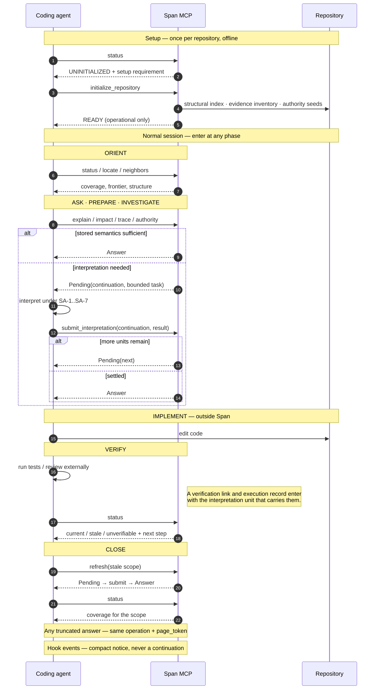

# Agent execution lifecycle

```
OFFLINE (dedicated setup session)
  initialize_repository → READY (no interpretation happens here)

NORMAL CODING SESSION (enter anywhere)
  ORIENT        explain (status only when status/freshness is the goal)
                locate / neighbors for structural orientation
  PREPARE       impact  (material changes: always before editing)
  INVESTIGATE   trace / authority (where required)
  IMPLEMENT     external editing tools
  VERIFY        status + external tests/review; record executions
                so a pass can be derived, not asserted
  CLOSE         refresh + status
```

## Interaction across the lifecycle



Every semantic operation has two possible outcomes: an answer, or a bounded
pending task. A pending task is completed with `submit_interpretation`; that
call returns the answer or the next task. This is why the exchange is a loop,
not a single call.

A truncated answer is continued with the **same operation** and its
`page_token`. A continuation and a page token are not interchangeable: the
first is an assignment, the second is a position. Hooks are outside this loop:
they report, never interpret, and never allocate a continuation.

## Status modes

`status` is one operation with four shapes, and the response names the one that
answered (`resolved_mode`):

| Mode | Target | Answers |
|---|---|---|
| `REPOSITORY` | omitted | persisted coverage frontier plus repository totals |
| `SCOPED` | selector, claim, relationship, or evidence scope | coverage for that scope |
| `CAMPAIGN` | `TargetId` | progress of one target campaign |
| `UNRESOLVED` | any target that did not resolve | why, and the next operation |

`HOOK_FAST` returns a separate compact notice, never a status content.

A campaign handle is durable for 90 days. When it is unknown or expired the
response says so and names the recovery: re-run `initialize_target` with the
same target scope and objective.

Span never edits target code, generates patches, runs tests, or orchestrates
workflows. The installer synchronizes the managed lifecycle block in the
target `AGENTS.md`; that guidance write is separate from semantic state.
When stored semantics are insufficient, the operation
suspends with a bounded task: interpret it with your own model,
submit via `submit_interpretation`, and continue — a submit may
return the answer or the next pending unit.

## Refresh scope types

```text
stale refresh:
  SubjectSelector OR EvidenceScope
  stale_only=True (default)

CURRENT/unchanged-source challenge:
  SubjectSelector only
  stale_only=false, but only against an already-persisted question
```

An `EvidenceScope` with `stale_only=false` is rejected: it is not an
unchanged-source challenge target. Ordinary scoped stale refresh continues
to accept either target type.

## Status entry guidance

Normal `status` names the next exact step in each non-current entry:

- `STALE` or `UNVERIFIABLE` → `refresh` with the exact `SubjectSelector`
  for that subject when no owning refresh operation is live; otherwise
  continue its returned continuation. An `UNVERIFIABLE` empty result proves
  nothing.
- `UNASSESSED` (no adopted question coverage) → question-local `explain`
  on that subject when no owning operation is live. If the operation has
  already suspended, continue its returned continuation instead.
- Pending or open question work → continue through the continuation
  returned by the operation that suspended. Pass it unchanged; never
  decode or synthesize it.

Hooks report the same distinction in compact form and never allocate a
continuation.

Refresh never establishes a subject's first semantic question. `UNASSESSED`
uses question-local `explain` unless that operation is already live; `STALE`
or `UNVERIFIABLE` uses `refresh` unless that refresh is already live.

## Refresh ownership

The agent that changes implementation or governing semantic evidence
owns the close-out sequence for the scope it affected (edit → scoped
status → external verification → explicit scoped refresh → scoped
status) in the same change — a `refresh` call without re-examination
proves nothing; adequacy is in the resubmitted content. Hooks stay
report-only and never refresh.
Neglected stale scopes remain visibly noncurrent; Span never presents
a stored `ANSWERED` as effectively current where required support is
stale or unverifiable. Full closeout duty: `skills/span/SKILL.md`
(Freshness, authority, and closeout); expansion: the same skill's
shared analysis-card and boundary guidance.

Every semantic write uses the same compact pending-task card: objective; exact
scope and exclusions; evidence and authority; material input-to-terminal path;
typed result; adversarial check; explicit disposition with requirements; and
fresh readback. The card is projected through the canonical `TaskBrief` and
does not add a second semantic state or quality model.

## Explicit target semantic establishment

After the repository is identified and confirmed ready (initializing it only
when `store_readiness` is `UNINITIALIZED`), an exact
directory or repository path supplied by the user becomes a host-owned
semantic campaign, not a stronger form of administrative readiness. That
supplied path is the complete semantic boundary. The canonical entry point
is `initialize_target` with the exact `EvidenceScope` and user objective.
Each pending task exposes that boundary separately from its current
structural anchor. The active agent uses structural and filesystem discovery
to partition that boundary into material areas, then drives the returned
typed units through investigation and `submit_interpretation` serially,
using the returned continuation; a malformed or validation-rejected unit
reuses the same continuation after correction, while an unknown, expired,
or lost continuation is recovered by re-running the idempotent original
operation (there is no reissue operation). `explain(establish_baseline=True)` remains for an ordinary
selected root without an exact target directory; it is not the exact-target
path. Every material area must end with persisted coverage or an explicit
`NOT_APPLICABLE`, `OPEN`, or `PENDING` disposition with its requirement; a
representative root, populated store, or `READY` response is not completion.
The agent preserves page tokens, resumes pending work, and performs
fresh-session retrieval before reporting the target complete. A request
without an exact target still requires an explicit bounded scope choice.

Target accounting constraint: structural candidates make the exchange
resumable; they are not semantic areas. Coherent grouping is host-owned and
must be recorded through canonical subjects, relationships, semantic question
coverage, and typed target-inventory accounting in the single
`TargetAssociation` carrier. Target-inventory assignment, evidence-backed
exclusion, or unresolved mapping is distinct from question-level
`NOT_APPLICABLE`. No second progress store, ledger, or writer exists.
`target_scope` alone does not prove grouping or completeness. The accounting
carrier and atomic result/store contract are defined by the interpretation
exchange.

Exact onboarding path: `docs/onboarding-runbook.md`.

## Initialization and store readiness

Initialization is explicit and administrative: identity, repository
state, provider-owned structural build when needed
(`ensure_current` into `<data-dir>/structural/<id>/`, wiring-only, no
target writes), evidence inventory, authority seeds, store
schema — then a readiness report. Repository state and the configured
authority seeds persist together in one atomic row. Omitted
`authority_seeds` preserves the seeds already configured for the
repository; an explicit empty tuple clears them; a non-empty tuple
replaces them. Persisted seeds are rehydrated by the shared context
opener after a process or host restart, so later operations do not need
the setup call repeated. The semantic store supports schema 9 only:
a fresh store is created at schema 9, an existing schema-9 store opens
normally, and any other store version fails closed with no runtime
migration. `span-install --migrate-store <repository-id>` performs the
explicit upgrade, including the schema-9 payload cleanup for stores written
by 0.8.0. Uninitialized repositories answer
`UNINITIALIZED` plus a setup requirement on every path; hooks and
queries never bootstrap implicitly. A failed provider build is an
actionable setup failure, never a usable provider; a dirty tree after a
successful build still provisions (provider available, freshness
UNVERIFIABLE). Readiness is operational state,
never semantic truth. After initialization, normal repository-level
`status(target=None)` is required to expose the bounded persisted
semantic-coverage inventory (covered/current, incomplete, stale or
unverifiable, unassessed, and explicit bounds), without a structural crawl
or interpretation. This inventory is distinct from readiness. The installed-runtime gate is covered by the installed-MCP acceptance lane in
`tests/integration/test_installed_mcp.py`.

## Workflow examples

- Investigate: `explain` unfamiliar target → `trace`
  upstream/downstream → `authority` on the governing claim.
- Baseline a subsystem: `explain(establish_baseline=True)` on the
  exact root → work admitted PENDING questions in order → synthesize
  only on established member evidence → report qualified sufficiency.
  Use this only for an ordinary selected root. For an exact user-supplied
  directory target, use `initialize_target` per the section above.
- Implement: `impact` with change kind + affected assertions →
  resolve blockers → edit → `status` → external tests →
  `refresh` → `status`. `refresh` reuses persisted question scope;
  it never starts a new baseline audit.
- Test/review: run the test externally, submit the verification link with
  the execution record, then read `status` for the derived currency
  (candidate/unknown vs current pass/fail/stale) — Span reports currency; it
  never runs tests and never accepts an asserted pass.
- Change-context: see `skills/span-change-context/SKILL.md`.

Root selection uses existing repository context plus bounded
structural operations. For an explicit target, the host performs the needed
partitioning outside the MCP structural port; the port has no unrequested
repository-wide enumerate/map. Normal repository-level `status` reads only persisted
semantic coverage and reports its bounded frontier; it never enumerates
structural subjects or interprets them. Skills are guidance only, never
semantic authority.

`store_readiness: READY` means Span storage/runtime readiness only. It is not semantic
completeness; coverage and currency are reported separately.

## Target mapping

`initialize_target` binds a bounded, deterministic batch of unaccounted
inventory members per mapping unit; every bound member receives exactly one
disposition (assignment, evidence-backed exclusion, or unresolved mapping),
validated atomically. Newly admitted areas take a service-owned first
`PENDING` CQ-01 seed when no reusable current question exists.
Use `status(TargetId)` to distinguish a live mapping unit, which continues
through its returned continuation, from unaccounted work with no live unit,
which reruns `initialize_target` with the same target scope and objective.
